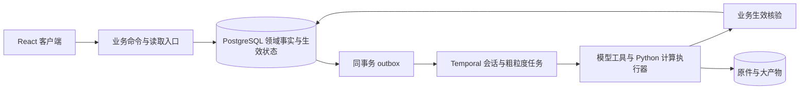

# 技术选型复审：让业务内核保留教学语义，让执行平台承担恢复

日期：2026-11-17。性质：评审建议，不替代现行 PRD、规格或 ADR。Goal 保持暂停，本次不安装依赖、不改产品实现。

Owner 后续决定：采用 §1 推荐的技术组合，转入产品功能与实现方式讨论。下述能力比较和待验证项继续保留；技术选择已获采用，不代表候选引擎的运行验收已经完成。

## 1. 建议

建议采用 **TypeScript 业务内核与产品模块 + Temporal 持久执行 + Python 计算执行器 + PostgreSQL/S3 + React PWA**。

这里最有把握的是恢复责任的调整：取消“队列加自行实现完整会话恢复”这条主线。控制面语言选择的把握低一些；TS 与 Python 都是有竞争力的方案，不能根据目前已有多少 TS 代码决定，也不能因为 Pydantic AI 有 Temporal 集成就决定全部后端用 Python。

**DBOS 是最强替代。**如果同库原子登记、较少独立服务的价值高于跨进程编排与执行平台独立运维的价值，应选 DBOS，并验证其恢复部署方式。Restate 也具备长流程、跨语言服务和版本治理，不能用“没有这些能力”排除它。

评判依据是目标能力的总维护成本：大量非 LLM 计算、复杂后台工作、多轮工具与等待、多端使用，以及低价模型能否独立完成局部修改。单学习者只说明用户数量，不能推出任务和恢复简单。已有 ADR 和实现均不作为沉没成本加分。

## 2. 当前决定需要纠正的地方

- [PRD §7](../PRD.md#7-技术决定)和 [ADR-0004](../adr/0004-single-postgres-no-workflow-engine.md)以单学习者和同库事务为理由排除工作流引擎，理由不充分。同库原子入队是真优势，但步骤恢复、并行汇合、等人、取消和升级后的续跑仍要有人维护。
- 当前的 `kernel/package.json` 只有 PGlite、pg 和 Zod 依赖；**pg-boss 尚未安装或接入**。此前把它当作已定方案太早。
- [ADR-0006](../adr/0006-gather-derive-split.md)的固定输入与纯计算适合统计、记忆模型和求解器。动态 agent 的“读资料→调用工具→根据中间结果再读”已经属于产品需求，不能靠不断增加槽位把正常循环拆碎。它应走受控会话宿主。
- TS 导出与静态依赖检查能约束普通开发，不是运行时权限隔离；“独立进程”本身也不保证网络、凭据和文件不可访问。学习者代码执行需要隔离，触发条件不能仅是引入外部作者的插件。

## 3. 持久执行的比较

| 方案 | 能交给它的责任 | 本项目仍须承担的责任 | 裁决 |
| --- | --- | --- | --- |
| Temporal | 持久步骤、等待与消息、并行子任务、重试/取消、执行历史和 Worker 版本路由 | 业务 PG 到引擎的可靠交接；业务生效核验；外部效果幂等与未知结果；生产服务运维 | 目标主线 |
| DBOS | 检查点、工作流/子工作流、等待与消息、队列、恢复和代码升级策略 | 所选部署形态的跨执行器恢复；业务生效核验；未知外部效果 | 最强替代，尤其适合同 PG 事务边界 |
| Restate | 持久 handler/步骤、服务间调用、等待、内建状态、不可变部署与旧调用路由 | PG 与引擎间交接；防止内建状态成为第二份领域事实；未知外部效果 | 有效候选，当前未证明优于前两者 |
| pg-boss + 自有会话恢复 | 作业投递、租约和重试，可与业务 PG 事务协作 | 完整步骤日志、循环恢复、等待/唤醒、并行汇合、执行版本与恢复工具 | 不推荐作为复杂会话的主平台 |
| 原生 goroutines | 单进程内并发执行 | 上述所有持久执行与业务语义 | 属于执行手段，不能替代引擎 |

Temporal 的版本路由和 Activity 重试有明确平台接口；Activity 尝试可能重新执行，需要业务幂等。它还需要独立的生产级 Temporal Service；开发用单进程 server 不等于生产部署方案。这里推荐它，是把通用恢复和部署版本责任交给独立执行平台的架构判断，**不是本项目吞吐、费用或恢复速度的实测排名**。[Worker 与版本部署](https://docs.temporal.io/best-practices/worker)、[Activity](https://docs.temporal.io/activities)、[生产部署](https://docs.temporal.io/production-deployment)。

DBOS 当前已有调用方事务内的 `enqueueInTransaction`，前提是连接到其 system database；它也支持跨语言应用通信、patching 和应用版本路由。不能沿用“只有队列能同库”“DBOS 没有版本管理”的旧印象。单节点启动恢复与多执行器恢复的协调方式需要分别评估；官方提供 Conductor，也允许其他恢复协调方式。某些自动升级能力属于 Enterprise，不能把它们算作基础自托管默认能力。[事务入队](https://docs.dbos.dev/typescript/reference/client)、[架构与恢复](https://docs.dbos.dev/architecture)、[代码升级](https://docs.dbos.dev/typescript/tutorials/upgrading-workflows)。

一个具体的取舍是并发 agent 序列：Pydantic AI 的 DBOS 集成要求耐久步骤以确定顺序启动；工具内部的多步异步序列相互交错时，可能恢复失败或同名步骤结果错配。官方办法包括串行执行，或把独立序列放进子工作流。这是需要验证宿主能否封装的实际成本，不等于 DBOS 不支持并行，也不是所有语言 SDK 的统一限制。[并发工具约束](https://pydantic.dev/docs/ai/capabilities/durable_execution/dbos/#parallel-tool-execution)。

Restate 的服务版本可以使用不可变地址，新请求去新部署，在途请求继续原部署。它支持 TS、Python、Go 等 SDK，也有 Pydantic AI 集成。当前没有充分证据给它贴“不成熟所以不行”的标签；需要比较的是状态所有权、PG 交接和本项目插件接入的实际成本。[能力与 SDK](https://docs.restate.dev/)、[版本治理](https://docs.restate.dev/services/versioning)、[Pydantic AI 集成](https://pydantic.dev/docs/ai/capabilities/durable_execution/restate/)。

pg-boss 的同事务适配值得保留在比较中，但事务性投递不能自动变成完整 agent 执行恢复。[事务适配](https://pgboss.io/api/adapters)。

这里按 **Go 原生协程**理解 goroutines。如果采用 Go，普通 Activity/计算宿主可以使用原生并发；Temporal Workflow 中则须使用确定性的 `workflow.Go`，不能直接用普通 goroutine。[Go SDK 并发规则](https://docs.temporal.io/develop/go/best-practices/multithreading)。

## 4. 语言与 agent SDK

| 布局 | 最有价值的局部性 | 实际代价 | 建议 |
| --- | --- | --- | --- |
| TS 控制面 + Python 执行器 | 命令、槽位、界面块和工具契约可共同生成与使用；纯计算独立 | Python 能力与控制面共同演进时，有跨语言协议成本 | 默认主线，中等把握 |
| Python 控制面 + TS 界面 | agent、统计、求解与后台领域逻辑常共同修改时，可少一条后端语言边界 | 仍需生成界面契约、限制模块导入；独立计算池依旧需要协议 | 强候选，不能因已有 TS 实现排除 |
| Go 控制面 + Python + TS | 控制面若有明确的并发、内存或部署收益，可独立优化 | 三种语言、三套类型与发布工具链；不能消除 Python 计算边界 | 目前缺少足够收益证据 |

默认选 TS 的理由是模块公开接口同时服务命令、视图、工具与界面，适合保持一处契约来源。**这不证明 TS 对便宜模型更可靠，也不证明 Python 做不到。**如果代表性新能力频繁要求共同修改 Python agent 和 TS 宿主，应在扩大实现前改选 Python 控制面。

当前 Temporal 已有官方 `@temporalio/vercel-ai-sdk` 集成，可以承接模型调用和 MCP 的耐久包装；普通自定义工具仍须明确使用 Activity 或 Child Workflow。实时输出通过外部流消费者传送，Workflow 内部在 Activity 完成后才获得可重放的结果。故“Temporal 只适合 Python”或“TS 必须自写整个耐久 agent 循环”均不成立。[官方 TS 集成](https://docs.temporal.io/develop/typescript/integrations/ai-sdk)。

Pydantic AI 的 Temporal、DBOS 和 Restate 路径都有效。注册时机、同步/异步工具、子工作流和并发步骤的约束须跟随具体集成版本处理；不能只挑 DBOS 的限制，而忽略 Temporal 集成也有运行时 toolset 注册边界。[Temporal 集成](https://pydantic.dev/docs/ai/capabilities/durable_execution/temporal/)、[DBOS 集成](https://pydantic.dev/docs/ai/capabilities/durable_execution/dbos/)。

建议 TS 会话宿主默认使用 Vercel AI SDK + Temporal 集成；确实依赖 Python agent 生态的能力可在独立 Python Workflow/Worker 中使用 Pydantic AI，经相同业务命令与读取契约接入。无需为每个能力同时维护两套 agent。AI SDK 的 `WorkflowAgent` 是另一条持久执行路径，不应再叠到 Temporal 上共同恢复同一个循环。[WorkflowAgent 的执行模型](https://ai-sdk.dev/docs/agents/workflow-agent)。

已核对官方插件源码的依赖及 peer 范围，包含 AI SDK 7 与 Temporal SDK 1.24 系列；这是文档/源码证据，**不是本仓库已安装并跑通这些组合**。真正接入时应锁定兼容版本并验证，而非安装所有包的 latest。[插件依赖声明](https://github.com/temporalio/ai-integrations/blob/main/typescript/vercel-ai-sdk/package.json)。

Vercel Workflow SDK 本身支持自托管 PostgreSQL World，不能当作必须购买 Vercel 才可用。但其 TS 工作流模型并没有提供足够理由让本项目增加另一套恢复系统；如果最终选择它，应作为对 Temporal/DBOS 的替代整体评估。[自托管 Worlds](https://workflow-sdk.dev/worlds)。

## 5. 保护优雅的责任边界

- **PG 是领域事实的唯一权威。**更正、输入清单、用途、候选接受、预算与外部效果账本归业务内核；Temporal 不决定“哪个判分现在有效”。引擎历史不作为业务查询库。
- **同一执行路径只有一个恢复权威。**步骤恢复、等待、重试和并行进度交给选定引擎。会话消息、审计记录、教学工作单仍可存 PG，但不再维护另一份决定下一步执行的游标；也不额外叠 LangGraph/checkpointer 来恢复同一个循环。
- **Temporal 与业务 PG 之间承认事务边界。**命令提交与 outbox 登记同事务；relay 允许重复投递，用稳定工作 ID 去重并保留失败重试/对账。不能声称数据库提交和启动 Workflow 天然同事务。若选 DBOS，同 system DB 的事务入队可替代这条 relay，但业务幂等仍在。
- **引擎不能消除未知外部结果。**收费请求已发生而回执未落盘时，任何引擎都可能面对 unknown。效果身份、发送前登记、provider 幂等键/查询、成本与原始回执仍须保留；无法查明时不能自动当作没发生而重发。SDK 与引擎不能分别无限重试同一收费操作。
- **取消与接受分开。**中止执行是尽力减少浪费；迟到结果能否生效仍须核验修订、用途和候选所有权。短事务/学习者写锁内不做模型或重计算。
- **依赖对业务模块隐藏，耐久语义保持明确。**不要为隐藏 Temporal 名字又实现一套通用工作流解释器。固定输入推导走纯函数；动态工具循环走会话宿主。若新能力无法由既有四种模块构件合理表达，按 PRD §11 重审，而不塞入逃逸回调或第五个事实所有者。
- **可替换有边界。**适配器隔离不等于在途执行历史能跨引擎热迁移。换平台需明确排空、停写或按业务账本重启的规则，不承诺一行配置完成。

现有命令执行器已有事务内 hook，可作为可靠工作意图登记的接点；DBOS 则需要在内部 PG 适配器接入原生事务 client，当前 `DbTransaction` 只暴露查询能力，不能宣称零改动接入。[命令 hook](../../kernel/src/commands/contracts.ts)、[事务接口](../../kernel/src/db/types.ts)。另外，引擎固定 Worker 版本并不能同时固定外部 MCP 服务或独立计算工具，方法与工具制品版本仍需记录。

## 6. 其余层的裁决

| 层 | 建议 | 原因与边界 |
| --- | --- | --- |
| 权威存储 | PostgreSQL；原件/大产物在 S3 兼容存储 | 事实和接受协议需要事务；大载荷不塞工作流历史。需要版本化迁移与恢复演练，建表时的 `IF NOT EXISTS` 不能代替迁移 |
| 客户端 | React 响应式 PWA；本地持久化命令队列与已授权工作集 | 多端使用本身不必然要求两套 UI；离线排队与服务端接受分开显示 |
| 同步 | 当前限定的视图缓存/命令离线可先不用复制引擎；完整离线工作集倾向 PowerSync | 一旦需要本地跨视图查询、较大工作集和长期离线演进，应交给成熟同步层；领域写仍走命令 |
| 非 LLM 计算 | Python 独立进程/容器，按资源类分队列；复杂多节点计算候选 Ray | 工作流负责可靠编排，计算运行时负责资源执行。常驻分布式集群不能只凭“以后计算多”决定 |
| 不可信代码 | 单独受限执行环境，限制凭据、网络、文件和资源 | 学习者程序与外部插件均可能触发；不能把语言类型或逻辑 CPU 数当安全边界 |
| 项目组织 | 一个业务内核、一套契约生成、逻辑模块按事实所有者划分 | 并行开发靠所有权与局部接口；并发写代码需要独立 worktree，不靠模型自觉避免冲突 |

PowerSync 会维护本地 SQLite 和上传队列，但后端仍负责验证与业务规则；应把本地命令交给受控上传入口，不能直接复制写入事实表。Electric 主要负责读路径同步，并非不能做离线，而是写入/排队方案需要另外组合。[PowerSync 写入模型](https://docs.powersync.com/client-sdks/writing-data)、[Electric 写路径](https://electric.ax/docs/sync/guides/writes)。

Ray 的 CPU/内存资源声明是逻辑调度约束，并非硬隔离；大量细粒度任务还要承担调度开销。是否引入它，应看代表性计算的资源局部性、数据共享与分布式执行需求，不能仅看一次全量任务耗时，也不能把 goroutines 当 Python CPU 计算加速器。[Ray 资源语义](https://docs.ray.io/en/latest/ray-core/scheduling/resources.html)、[细粒度任务开销](https://docs.ray.io/en/latest/ray-core/patterns/too-fine-grained-tasks.html)。

契约需要补强：当前 [ValueSchema](../../kernel/src/declarations/types.ts)只要求 `parse()`，不足以保证工具参数、HTTP 与跨语言协议能自动生成。建议采用可导出的受限 schema 子集，显式版本化；语义检查另外执行，不能把无法表示的规则静默降级成任意值。Zod 4 有 JSON Schema 导出，但并非每种 Zod 类型或检查都能转换。[Zod 的转换边界](https://zod.dev/json-schema)。

## 7. 作出最终架构决定前的最小证明

以下是选型验证义务，**本轮未执行**，不是产品开发排期。先验证少量能推翻选型的纵向样例，不为每个候选搭一整套产品。

比较时控制变量：平台实验用同一个 Python agent 分别接 Temporal 和 DBOS；语言实验固定 Temporal，对比 TS 官方插件与 Python Pydantic AI 的同一条工具链，再各新增同一种命令。记录手写适配、重复 schema、跨所有者修改和修复轮数。DBOS 如果通过相同故障样例且自有机制更少，应推翻 Temporal 推荐；Python 如果明显减少共同修改边界，应推翻 TS 控制面推荐。

| 样例 | 要观察什么 | 什么结果推翻建议 |
| --- | --- | --- |
| 备课：多轮工具、并行求解、等人、杀 Worker 后恢复 | 已完成步骤复用；独立计算不中断学习者命令；等待与取消可诊断 | 为接引擎仍需维护独立的完整步骤恢复系统 |
| 域事务提交后、发给引擎前宕机；重复交接 | 工作不丢失；重复交接不制造第二个逻辑效果 | outbox/稳定 ID 不能闭合交接，或其维护成本明显超过 DBOS 同库方案 |
| 模型回执丢失，同时撤销用途或更正输入 | 原始失败保留；unknown 不盲重发；迟到候选不生效 | 任一 SDK/重试层绕过账本或业务接受核验 |
| 旧工作流等人期间部署新代码、工具 schema 与 SDK | 旧执行可继续或明确失败可修复；新执行按新版本；流式断线可重新连接并获得最终状态 | 简单新增能力必须理解/修改大量历史分支或中心注册表 |
| 新增一个需要 Python 求解并读写领域记录的 agent 能力 | 记录修改的所有者、契约文件、人工返工和集成轮数 | Python 与 TS 控制面经常共同修改，而 Python 控制面可明显减少这条边界 |
| 两设备离线编辑、重连、命令重复/冲突；新增一个离线视图 | 命令幂等、期望修订、缓存与权威状态区分清楚；新增视图无需手改多套同步逻辑 | 简单缓存不断长成自制同步引擎，应直接使用 PowerSync 等方案 |

测试代码占比继续不超过 10%，不靠增加生产代码、压缩测试或隐藏 fixture 达标。把预算放在公共行为、真实故障与契约兼容上；静态边界与行数检查保留，但不把它们当作可维护性证明。

独立复核运行现有预算脚本得到 **253 / 2949 = 8.58%**；其代码扩展名口径目前仅覆盖 TS/JS。未来引入 Python/Go 时，必须先扩为跨语言统一统计，并继续覆盖测试支持、fixture 和生成器内嵌测试；不能把未统计的代码算作已经符合 10%。[当前预算脚本](../../scripts/check-test-budget.mjs)。本轮只指出缺口，没有修改脚本或新增测试。

本次证据等级：本地规格/实现核对、官方文档与公开源码；有独立语言/agent 调研和架构复核。没有运行候选引擎，没有实测性能、运营费用、跨版本恢复、真实 provider 效果或浏览器离线同步。推荐是有依据的架构判断，运行时接受结论仍为 **NOT_RUN**。
