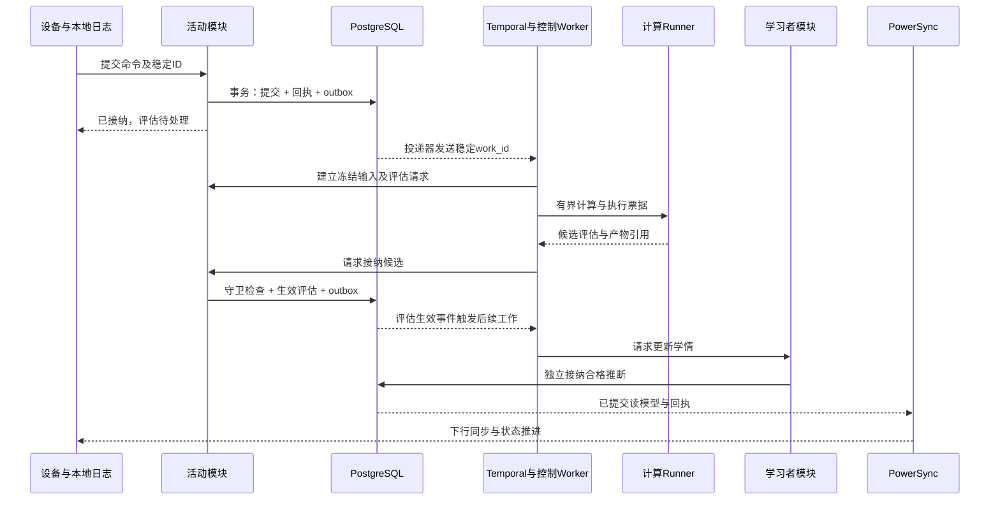
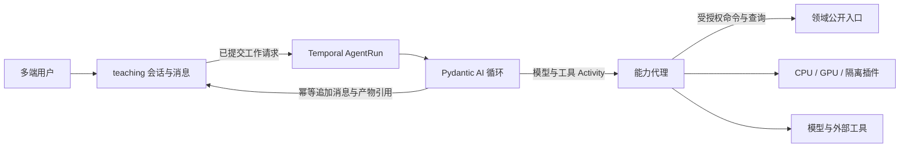
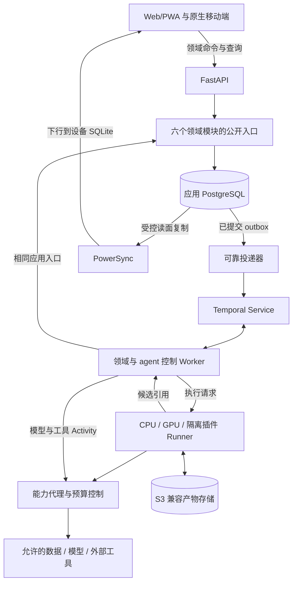

# the-learning-project 架构设计与技术选型

**2026-11-15｜设计提案｜对应 [重构 PRD](refactoring-prd.md)**

本文把 PRD 中的要求落实为模块、进程、存储、协议和一致性机制。仅产出设计，不包含应用代码、部署操作或版本计划。技术能力依据官方资料核对；设计中的性能和开发效率判断仍需通过文末的验证场景证明。完整的备选比较、选择依据与维护代价见[技术选型裁决](technology-decisions.md)。

设计假设：同一学习者跨设备、自托管优先、可以使用本地及远端算力；后台计算规模远大于在线事务量。系统应允许增加算法、模型、工具和插件，但不能要求每个扩展重新理解全系统。

## 1. 架构决策

采用**模块化单体承载业务权威，独立执行层承载计算，客户端通过统一业务协议与同步协议工作**。

“单体”指领域实现同仓、统一发布、能在同一数据库完成必要事务，不代表所有工作在同一个进程，也不代表所有模块共享任意写权限。计算节点、同步服务、工作流服务可以独立部署与扩容。

架构有四条固定边界：

1. **领域模块决定什么成立。** 作答是否接纳、哪个判分生效、某条学情是否有效、计划是否可发布，都属于指定模块。
2. **工作流决定工作怎样继续。** 它持久化等待、分支、重试、取消和版本，不自行发明教学政策。
3. **计算执行器产出候选。** CPU、GPU、外部模型、符号求解器和插件统一受资源与权限控制，不能直接改业务表。
4. **客户端管理交互与本地未同步工作。** 它可以离线保存和呈现乐观状态，正式业务效果仍由领域命令接纳。

具体技术主线是 **Python / FastAPI / Pydantic + PostgreSQL / SQLAlchemy / Alembic + Temporal + Pydantic AI + PowerSync / SQLite + React / Expo**。计算插件按类型化契约接入，非受信任代码通过 OCI/gVisor 隔离。

选择依据是总维护成本：业务、计算和 agent 能共用哪些契约；哪些复杂机制由成熟组件承担；错误能否在整合前被机器阻止；增加一种能力需要修改多少共同代码。旧项目使用过什么不计入选型理由。“轻量”“模型熟悉”或跑分更快也不足以单独决定框架。

这次明确改变业务后端的语言与 HTTP 框架，并为 agent 选定实际运行时。仍选择 PostgreSQL、Temporal、PowerSync 等组件，是因为它们分别满足事务权威、耐久执行与设备持久同步要求；每项均重新比较替代方案，不能由旧栈自动继承。

## 2. 模块与数据所有权

### 2.1 六个业务模块

| 模块 | 拥有的数据与判断 | 典型公开操作 | 不负责 |
| --- | --- | --- | --- |
| `records` 学习记录 | 原件、外部经历、解析修订、来源定位、材料用途与删除状态 | 接纳来源、确认解析、更正解析、改变用途、导出来源 | 题库发布、正式判分、学情更新 |
| `content` 内容与知识 | 发布材料与版本、题目与评分标准、知识身份/关系、学科语境、内容准入 | 发布内容、修订知识结构、取得内容版本、查询可服务能力 | 覆盖原件、保存学生作答、计算个人掌握度 |
| `activity` 学习活动与评估 | 活动实例、冻结要求、作答草稿与正式提交、生效评估 | 开始/恢复活动、保存草稿、提交作答、接受评估、纠正评估 | 调用方自行挑选哪个候选生效、更新计划 |
| `learner` 学习者模型 | 合格证据集、学情推断、记忆状态、推断的条件与不确定性 | 建立证据快照、读取学情、接受估计、撤回或重建推断 | 重新解释评分、修改学习者目标 |
| `planning` 目标与安排 | 目标、时间预算、锁定安排、计划版本与取舍 | 修改目标、请求规划、接受候选计划、调整或锁定安排 | 直接写学情、生成一题就宣布备课完成 |
| `teaching` 教学与准备 | 教学会话、帮助过程、教学方法、备课需求及成果关联 | 提供/继续帮助、提出准备需求、接受教学步骤、停止干预 | 任意修改前五个模块的表或判定 |

这六个模块是业务责任的分组，不是六个超大文件，也不是六个独立数据库服务。内部按能独立承担完整操作的职责继续组织。

**原件、解析、发布、发放分别有身份。** `records` 保留文件及解析修订；`content` 发布引用该修订的内容版本；`activity` 冻结实际给学习者的内容与要求。修改 OCR 不直接覆盖已经发出的题面；更正会触发明确的重新评估与失效处理。原生作答和观察仍由 `activity` 保存，记录页面通过查询汇总，不复制另一份事实库。

### 2.2 平台能力的边界

| 平台能力 | 负责 | 不得吸收的业务语义 |
| --- | --- | --- |
| `identity-access` | 人、设备、执行实例、授权与撤销 | 什么分数代表掌握、什么安排值得做 |
| `consistency` | 版本守卫、依赖凭据、原子接纳与失效检查 | 如何判分、如何估计能力 |
| `jobs` | 工作请求投递、工作流关联、执行身份与预算 | 一份学习计划的具体取舍 |
| `execution` | 运行计算、保管凭据、能力接口与资源限额 | 代替领域接受结果 |
| `agent-runtime` | Pydantic AI 与 Temporal 集成、工具适配、运行定义装配 | 会话事实、学情真值、自己的授权系统或另一套恢复引擎 |
| `replication` | 可同步读模型、客户端回执与设备状态 | 同步 CRUD 即视为正式业务提交 |
| `storage-observability` | 对象存储、索引、运行记录与关联追踪 | 用日志代替业务记录或费用账 |

这些是同仓的基础包与少数运行服务。不会为每一行创建一个微服务。平台只承接确实重复且需要统一保证的机制。

### 2.3 允许的依赖方向

各业务模块公开三种内容：**契约、命令/查询入口、对外事件**。调用者可以依赖契约，不能导入实现内部、存储模型或锁辅助函数。

跨域编排通过明确注入的少数接口完成。比如规划工作流读取 `learner` 的学情快照和 `content` 的材料能力，再向 `planning` 递交候选。工作流属于 `planning` 的应用层，其核心决策不反向依赖 Temporal 或具体模型。

客户端依赖生成的协议类型及自己的呈现代码。计算插件依赖执行协议和所在扩展位置的契约。只有应用组合根可以组装具体模块实现。

不建立一个可以从任何地方查找所有模块的全局容器，不在 `shared` 中堆积领域政策；共享基础类型限于身份、版本引用、错误信封等确实共同的概念。

## 3. 仓库与接口结构

### 3.1 物理组织

以下路径描述目标结构，本次没有创建这些目录或代码。

| 位置 | 内容与写入责任 |
| --- | --- |
| `apps/api` | HTTP、身份入口与组合根；不写评分、学情或规划政策 |
| `apps/control-worker` | 工作流宿主、可靠请求投递与受信任领域命令执行 |
| `apps/web`、`apps/mobile` | Web/PWA 与原生移动交互；各自独立 UI，消费共同协议 |
| `modules/<domain>/contract` | 本域 Pydantic 传输模型、导出的 Schema、操作说明、错误语义与兼容样例 |
| `modules/<domain>/core` | 领域决策与不变量；不引入 Web/队列/模型 SDK |
| `modules/<domain>/application` | 完整命令、查询及流程协调；调用本域 core 与受限依赖 |
| `modules/<domain>/adapters` | 本域 SQL、HTTP、工作流和索引实现 |
| `modules/<domain>/agents` | 本域的 agent 定义、指令与评估样例；依赖公开能力，不获得数据库直写权 |
| `modules/<domain>/migrations`、`acceptance` | 本域不可变迁移与真实边界的行为证明 |
| `platform/*` | 前述基础机制，变更范围受保护 |
| `extensions/<extension-id>` | 一个解析器、评分方法、规划器或其他扩展的完整交付单元 |
| `clients/shared` | 协议生成物、本地命令日志、同步适配、无业务决策的交互工具 |

这里的分层发生在模块内部。不会把整个仓库切成一个 controllers 目录、一个 services 目录和一个 repositories 目录，让任何功能都跨越几个共同大目录。

### 3.2 契约的唯一来源

契约的作者来源是各域独立的 **Pydantic v2 传输模型**；它们不导入领域实现、数据库或 agent SDK。由它们生成 **JSON Schema 2020-12**，由 FastAPI 的薄路由装配生成 **OpenAPI 3.1**。HTTP 请求、工具参数和计算结果共享建模机制与稳定基础类型，确属同一业务协议的入口复用具名模型。持久化的 Workflow、Activity 与 Signal 载荷另行具名、版本化，不直接跟随 HTTP DTO 改动；新入口向旧运行发消息时负责显式兼容转换。领域内部对象与 SQLAlchemy 表模型仍各自独立，不能以“共享模型”为由混成一个万能类。[Pydantic Schema](https://pydantic.dev/docs/validation/latest/concepts/json_schema/)、[FastAPI](https://fastapi.tiangolo.com/features/)、[OpenAPI](https://spec.openapis.org/oas/v3.1.1.html)。

命令模型默认严格校验并拒绝额外字段；请求与响应分别声明。客户端使用 `openapi-typescript` 生成类型，使用 Ajv2020 验证需要的外部数据；第三方执行器消费导出的 Schema，不必安装 Python 业务包。生成物不可手改，CI 检查重新生成后没有漂移。[严格模式](https://pydantic.dev/docs/validation/latest/concepts/strict_mode/)、[openapi-typescript](https://openapi-ts.dev/introduction)、[Ajv 方言](https://ajv.js.org/json-schema.html)。

协议限制为可移植的 JSON 类型、具名对象与带判别字段的联合。时间、精确金额和超大整数使用明确的字符串格式。传输契约不依赖无法导出为 Schema 的自定义转换器或隐藏校验；业务校验属于应用入口，并以业务错误返回。Python/JSON 输入的严格模式行为并非完全相同，两端共同运行合法/非法样例，验证数字、空值、额外字段、日期和枚举的一致性。模型提供方要求的工具 Schema 是契约的适配表示，不能反向改写正式业务协议。

模块公开操作按业务语义命名，例如“提交作答”“接受计划”，不提供“更新任意列”。HTTP 适配层、工作流 Activity 与后台工具调用同一个应用入口。

### 3.3 三类协作消息

| 消息 | 必须包含的语义 | 处理方式 |
| --- | --- | --- |
| 业务命令 | 稳定命令 ID、目标身份、预期版本、主体与设备来源、用途、协议版本 | 领域检查授权及版本后原子接纳；重试返回同一回执 |
| 已提交事件 | 事件 ID、所属模块、对象与版本、事件类型、原因关联 | 表示已经发生；消费者幂等处理，不能把它当未经验证的写指令 |
| 计算请求/候选结果 | 逻辑执行 ID、输入清单、方法/镜像版本、资源与预算、输出契约、执行凭据 | 执行器返回候选；所属领域经过有效性和业务规则检查后接受 |

命令回执至少区分：已拒绝、已接纳待计算、已产生正式结果；HTTP 连接是否成功不是业务结果。相同命令 ID 携带不同内容必须拒绝；不同的真实练习不能因答案文本相同被去重。

### 3.4 协议演进

服务端和客户端会长期不同版本。兼容性检查针对实际消费者；新增字段不能默认可被旧客户端安全解释，新枚举必须有具名的未知处理。改变含义或接受条件属于契约变更，不能只保持字段名不变。

每个可用客户端与执行器声明兼容范围。需要升级的操作返回可恢复状态，本地未同步内容仍可读取导出。插件升级绑定具体版本；已有任务不自动运行最新插件代码。

## 4. 存储与事务设计

### 4.1 选 PostgreSQL 18，业务按 schema 分权

业务数据库采用 **PostgreSQL 18** 的当前维护小版本。关系约束、事务、并发锁和数据库权限直接对应本系统的正确性要求；全文和向量索引还能复用同一运维基础。18 是正式维护系列，选择它获得较长的支持窗口，不因旧项目或上一稿使用 17 而沿用。实际发行组合仍须验证驱动、Temporal、PowerSync 和 pgvector；这里没有声称已经运行兼容性测试。[版本政策](https://www.postgresql.org/support/versioning/)。

数据库访问选 **SQLAlchemy 2.1 Core + psycopg 3**，迁移选 **Alembic**。默认使用 Table 元数据、显式 `select`/DML 和显式短事务，不引入 ORM Session 的对象图、autoflush 和懒加载。行映射只存在于存储适配器内部，返回前构造具名 DTO；并发命令各自持有连接与事务，不把请求连接交给后台工作。确需 ORM 的局部适配器必须单独说明理由，禁止跨域 relationship、隐式级联和向外返回 ORM 实例。[SQLAlchemy Core](https://docs.sqlalchemy.org/en/21/core/index.html)、[Session 行为](https://docs.sqlalchemy.org/en/21/orm/session_basics.html)。

`records`、`content` 等运行连接分别使用受限数据库角色；角色只可写所属 schema，访问平台表通过受限函数或明确授权。运行账号没有 DDL 权限。迁移账号与运行账号分离。schema 本身只是命名和权限组织，不是天然隔离；同进程仍是同一信任域，不能把这些角色包装成抵抗恶意宿主代码的保证。[PostgreSQL schema 与权限](https://www.postgresql.org/docs/18/ddl-schemas.html)。

跨域查询调用公开读面；高频组合查询由明确的读模型提供。禁止任意代码以“查询方便”为由跨域写表。跨域对象引用使用稳定 ID、精确版本与明确有效性规则；不采用隐含跨域删除级联。

### 4.2 哪些数据住在哪里

| 数据 | 存储 | 能否重建 |
| --- | --- | --- |
| 来源元数据、发布版本、提交、生效评估、目标与安排 | 各领域 PostgreSQL 表及必要历史 | 业务事实不能从模型输出重新猜测 |
| 原图、PDF、媒体、输入快照、模型/算法输出、检查点 | S3 兼容对象存储，后端须通过实际使用操作的兼容验证 | 原始材料不应依赖重建；派生产物有来源和保留规则 |
| 搜索与向量索引 | PostgreSQL 全文索引/pgvector，独立索引读面 | 可从仍获授权的来源重建，不作为事实权威 |
| 工作流执行历史 | 工作流服务自己的持久化库 | 不用它重建整个人的学习史 |
| 客户端已同步读面 | 设备 SQLite | 可重新同步；未同步工作必须单独保护 |
| 运行轨迹、指标和诊断日志 | OpenTelemetry 输出到可替换后端 | 不承担幂等、授权或费用结算职责 |

`pgvector` 提供 PostgreSQL 内的向量搜索，但相似度、向量新鲜度和业务有效性仍由应用定义；索引必须带来源版本与索引方法版本。[pgvector 官方仓库](https://github.com/pgvector/pgvector)。

大对象先上传到暂存位置并校验内容摘要，再由领域事务接受其引用。事务失败留下的暂存对象可回收；已引用对象不能被普通清理任务删除。有效性与删除状态保存在业务库，不能只靠对象存储路径猜测。

### 4.3 一个命令的事务边界

领域命令在一个短事务内完成：权限与预期版本检查、业务状态变化、版本守卫变化、回执，以及需要的 outbox 记录。事务内不做模型请求、文件下载或长计算。

事务提交后，投递器读取已提交 outbox，向工作流服务发送稳定身份的启动或通知请求。发送成功但回执未落库时可重试；收端以逻辑工作身份去重。outbox 解决业务提交与工作请求之间的可靠交接，不是另一套任务调度器，也不允许给任意事件再制造一条无限重试链。

启动同时约束运行中冲突与已结束 Workflow ID 的重用；不能只设置一个相同 ID 就假设不会重复运行。业务工作回执的保留期独立于 Temporal 历史保留期：历史过期后重投旧 outbox，仍由业务回执阻止再次启动。结束前幂等提交业务终态，丢失完成通知时按工作身份对账，不从“查不到工作流”推断从未执行。

接纳命令失败时不能发出有效工作；工作流服务暂时不可用时，已确认提交仍保留，回执显示等待后台处理。外部效果不参与数据库事务，按独立效果身份和恢复规则处理。

### 4.4 并行迁移的约束

迁移文件归模块，采用 Alembic 的多版本目录与具名迁移分支；每个领域有明确的已接受 head。并行变更产生分叉时添加 merge revision 并验证语义，不重写已经应用的历史。跨域依赖显式声明，发布物记录完整 revision 集合。迁移脚本不得导入会随业务变化的运行模型；autogenerate 只产生待审候选，不能自动发布。[Alembic 分支](https://alembic.sqlalchemy.org/en/latest/branches.html)、[自动生成的限制](https://alembic.sqlalchemy.org/en/latest/autogenerate.html)。

整合时生成确定的发布迁移集合，并校验依赖与已应用历史；数据库迁移只有一个实际执行者。分支之间若出现顺序或依赖冲突，必须整合后在干净数据库及既有数据库副本验证。自动编号不会使冲突自动正确，不能把允许乱序当默认逃生口。

跨模块 schema 依赖尽量由稳定标识和契约替代；确有外键或数据转换依赖时写明生产者版本，作为受协调的变更。备份回退和恢复不会自动撤销外部副作用。

## 5. 更正、异步推断与结果生效

这是整个设计中必须统一实现的机制。否则同样的“已更正，但旧后台结果又覆盖回来”会出现在每个插件和工作流中。

### 5.1 不可变输入清单与有效性守卫

每次计算使用一份持久化的**输入清单**：所用对象与精确版本、可读取对象引用、用途授权、方法版本、数据截止范围、目标对象的预期版本。宿主生成清单，插件不能自行删掉不利的依赖。

清单按修订保存，每个修订不可变。代理动态读取时，宿主先持久化实际读取的精确版本及继承的依赖，再把数据释放给执行器；新增读取生成新的清单修订。产出候选时必须封口，候选、检查点和缓存键绑定**已封口修订及其摘要**。封口后继续读取需要新修订与新候选，不能悄悄改变旧候选的依据。

平台维护小型的**版本守卫**记录：键标识某个对象版本或一个有明确定义的证据范围，值表示它的有效性版本与当前使用资格。守卫只保存技术凭据，不保存评分规则或学情算法。拥有源数据的模块在源事务里更新相应守卫；其他模块不能声称自己是源数据所有者。

必须区分两种引用：

- **固定版本仍有效**：已经发给学习者的题面可以继续使用，不因后来发布新版而失效。
- **必须跟随当前状态**：目标、用途授权、被更正的事实或生效判定改变后，旧依赖不能继续支持新的正式结果。

新增观察与撤销旧依据也不同。快照可以截至某个证据范围并诚实标明新鲜度；已撤销或纠正的依据不能通过标注“旧快照”继续获得当前生效资格。

### 5.2 传递依赖不能只靠异步通知

学情依赖评估，计划依赖学情。计划的输入清单必须继承学情所依赖的有效性凭据，而不只检查学情缓存行自己的版本。宿主合并直接和传递凭据，记录为可复用的不可变依赖集合。

依赖很多时，可以使用由源模块维护的范围守卫，例如“某学习者某学科的证据集合”。它可能引发保守的额外重算，但不能漏掉范围内相关更正。范围的归属与失效条件是受保护的契约，不能由插件自行缩小。依赖集合过大必须显式拆分计算或使用已证明完整的范围，不截断后当作完整。

### 5.3 原子接纳协议

结果正式生效时，所属领域开启一个短事务：

1. 从宿主保存的输入清单取得所有相关守卫，按固定顺序取得读锁；对本次要修改的守卫预先取得写锁，不在事务中临时升级锁。
2. 核对有效性、用途、方法激活状态、当前执行资格和目标的预期版本。检查发生在取得锁之后。
3. 执行本域接受规则，原子写入新结果、当前有效指针、依赖凭据、回执和后续 outbox。
4. 提交后释放锁。所有修改相关源状态的命令也先按同一顺序锁定守卫，再修改自己的业务行。

具体采用 PostgreSQL 冲突的行锁：读取有效性使用 `FOR SHARE`，更新守卫使用相应写锁；不将较弱的 `FOR KEY SHARE` 当作等价替代。锁仅覆盖相关对象或范围，计算本身不占锁。[PostgreSQL 显式锁](https://www.postgresql.org/docs/18/explicit-locking.html)。

如果更正先提交，接纳时看到新守卫而拒绝旧结果；如果接纳先获得相关锁，更正排在它之后，更正事务的守卫变化立即使该结果不再具有当前资格。下游读面在标为“当前”或触发行动前核对凭据，异步失效消息只负责清理、刷新和重算。

“失去当前资格”不删除历史结果。页面可展示明确标注的旧结果；新的正式评估、计划接受和自动行动必须使用符合本次规则的依据。

### 5.4 这个机制的成本

它增加一次有界的凭据读取和短事务校验，并让源更正必须遵守共同锁序。收益是各插件不再分别实现跨域新鲜度推断。范围过宽会导致无效重算、守卫热点或长期任务难以接纳，必须以实际任务验证；不能把它扩成全库一把锁。

大量数据的输入快照由受信任模块在一致的读取范围内构建，保存来源版本与内容摘要；不依赖最大自增 ID 证明“所有之前的事务都处理完了”。大型快照生成有独立资源限制，不以长时间锁住在线表实现一致性。

## 6. 后台任务：选择 Temporal 作为唯一耐久编排层

### 6.1 为什么选它，以及代价

选择 **Temporal 自托管服务 + Python 控制工作流与 Activity**。它承担持续数分钟到数天的工作、等待学习者回应、受限扇出、重试、取消和在途代码版本。计算后端可以使用其他语言；这不要求业务控制面同时维护多个 SDK。

DBOS 确实更轻：普通部署只需要应用和 PostgreSQL，也支持跨语言应用协作。它是很有力的替代方案。这里选择 Temporal，是因为本项目把多进程计算、复杂长流程和在途版本治理视为常态，希望这些能力集中在一个明确的执行控制系统内。这个判断是目标取舍，不是“DBOS 不支持复杂任务”的事实判断。[DBOS 架构](https://docs.dbos.dev/architecture)、[Temporal Activity 与跨 SDK 调用](https://docs.temporal.io/activity-definition)。

代价必须接受：多一项需要备份、升级和监控的核心服务；工作流代码需要遵守重放约束；旧运行需要兼容的 Worker；运维负担显著高于进程内队列。持续运行使用正式 Temporal Server，不把开发服务器当生产部署。持久化与 visibility 采用其支持的 PostgreSQL 配置，独立于应用库的数据库与账号。[Temporal 自托管部署](https://docs.temporal.io/self-hosted-guide/deployment)。

不同时保留 DBOS、pg-boss 与 Temporal 分担相同的业务调度责任。数据库 outbox 只投递，计算后端只执行；工作流才拥有工作如何继续的决定权。

### 6.2 工作流与执行器分别做什么

| 场所 | 允许执行的工作 |
| --- | --- |
| 普通领域命令 | 短事务、必要的小型确定性计算、检查与接纳 |
| Temporal Workflow | 安排步骤、等待结果或人类事件、超时决策、选定已批准的后续分支 |
| 受信任的领域 Activity | 建立输入快照、发起计算、查询执行、调用领域接纳入口 |
| 计算 Activity / Runner | 下载获准输入、运行算法或插件、保存候选、上报心跳与资源消耗 |
| 能力代理 | 根据执行身份提供特定数据、模型调用和工具操作，记载有成本或副作用的调用 |

工作流的决定必须可以按其历史重放。数据库读取、时间相关外部判断、随机推理和网络调用放在 Activity 中，并把结果保存为后续决策依据。对学习者的长期历史仍由业务模块拥有，不能埋在工作流历史里。

工作流模板按业务操作组织，如“处理一次来源导入”“评估一次提交”“形成一份候选计划”。不会给每个学习者创建一个无限增长、拥有全部记忆和职责的永生流程。

### 6.3 标识与状态不得混用

| 标识 | 含义 |
| --- | --- |
| `command_id` | 一次用户或系统业务意图，网络重试不改变 |
| `work_id` | 这次意图下的一项持久工作，保存在业务请求与 outbox 中 |
| Workflow ID / Run ID | 工作流平台的运行身份；重启、延续不替代业务身份 |
| `execution_id` | 固定方法、初始输入与授权范围的逻辑执行；重试沿用身份，实际输入由候选绑定的封口清单修订确定 |
| `attempt_id` + fencing token | 真正的一次执行尝试及其当前提交资格 |
| `effect_id` | 一次收费调用或外部副作用的语义身份，跨执行重试保持稳定 |

执行票据记录输入清单、根预算身份、已保留预算、尝试及提交资格；外部 Runner 才按需要附加租约信息。它不另设任务轮询和指数重试系统。Temporal 决定是否重试；票据负责证明本次尝试有权运行及提交。

### 6.4 从“提交作答”到“学情更新”

图中数据库到工作流的箭头由可靠投递器执行，不是数据库直接调用工作流。评估完成、学情更新、计划刷新是不同的业务状态：评估已经生效时，不必等待整套后台链条才能确认学习者交卷成功。

### 6.5 重试、取消、扇出与代码升级

- **重试只有一个总预算。** 领域规定可重试错误和停止条件；Temporal 执行重试策略。模型 SDK、HTTP 客户端、Ray 适配器不得再叠加不受计量的独立重试。
- **取消先撤销资格。** 取消命令提交时撤销本工作继续生效及获得新效果准入的资格，再向工作流和 Runner 发停止请求。已在取消之前获得准入的效果明确列为在途，即使网络请求尚未完成；系统尽力停止，但不谎称已经撤回。返回“停止请求已接受”不代表外部进程已退出。晚到结果作为历史候选保留，不能变为正式结果。
- **失败需要有类型。** 输入无效、不可行、资源耗尽、过期、取消、暂时故障、外部结果未知各自处理；不能全部转为成功空值。
- **扇出分批且有背压。** 批量资料处理把分区清单和产物存对象存储，每个工作流只持有有限活动窗口。子工作流按独立恢复单元划分；不用一个父流程启动无限多个子流程。
- **工作流版本与算法版本分开。** 默认固定 Worker Deployment Version；在有明确迁移边界时使用 Continue-as-New，并处理仍在运行的子任务。旧 Worker 的退役以在途运行核对为依据，不能部署新版后直接关旧版。算法/插件版本另外固定在输入清单中。

Temporal 的 Activity 可能实际执行多次；工作流历史和未完成操作也有边界。其版本管理机制降低兼容负担，但不会消除部署、排空和恢复责任。[Activity 幂等](https://docs.temporal.io/activity-definition)、[执行限制](https://docs.temporal.io/workflow-execution/limits)、[Worker Versioning](https://docs.temporal.io/production-deployment/worker-deployments/worker-versioning)。

## 7. 计算层：异构执行，统一接纳

### 7.1 计算不等于调用模型

| 工作形态 | 默认执行方式 | 可能的方法 |
| --- | --- | --- |
| 小型、短时确定性判断 | 领域内纯函数 | 规则、评分聚合、约束检查 |
| CPU 密集批处理 | Python OCI Worker；必要时调用编译库 | OCR 后处理、统计拟合、记忆模型、图算法、符号验证、约束求解 |
| GPU 计算 | 独立受信任 Python Worker 与固定镜像 | 表征计算、视觉/语音、本地模型推理、批量实验 |
| 外部模型与工具 | 受控 I/O Worker 和能力代理 | LLM、多模态服务、检索和允许的外部工具 |
| 跨节点、紧耦合批任务 | **Ray 计算后端**，由 Temporal 中的一个粗粒度操作管理 | 分布式训练、数据分区计算、需要数据局部性的批推理 |
| 不受信任扩展 | 隔离 Runner | 第三方解析、转换、验证或受限工具使用 |

Python 是业务、工作流、agent 和科学计算的默认语言，TypeScript 用于客户端。控制面目标运行时为 **Python 3.14 的标准构建**；科学计算扩展按各自依赖固定 Python/原生库镜像，不让某个 GPU 库绑住全系统版本。Rust/C++ 作为算法库或独立执行器接入。Node.js 只承担客户端工具链，不再是业务服务器运行时。[Python 支持周期](https://devguide.python.org/versions/)。

同一种语言不意味着同一进程或同一依赖环境。API、控制 Worker、模型 I/O 与 CPU/GPU 池独立运行；控制包禁止导入科学计算和插件实现。FastAPI 的请求后回调不承担持久任务，CPU 密集工作不能因使用 `async` 就在 API 事件循环中运行。[FastAPI 后台工作的边界](https://fastapi.tiangolo.com/tutorial/background-tasks/)。

### 7.2 Ray 的明确位置

普通独立 CPU/GPU 作业由专用 Temporal Worker 执行，无需 Ray。需要集群内数据分布、任务放置和并行计算时，选定 Ray 作为计算后端，而不是让它管理学习业务的耐久流程。

一个 Ray 作业对应一个逻辑执行。适配器用稳定 submission ID 提交或查询已有运行；重入先核对已有作业。结果未知时进入核对状态，不盲目启动另一个收费或高成本作业。Ray 中的临时对象不能当作持久检查点，需恢复的状态写入对象存储。[Ray Job submission](https://docs.ray.io/en/latest/cluster/running-applications/job-submission/doc/ray.job_submission.JobSubmissionClient.submit_job.html)。

集群内部的纯计算重试可以由 Ray 执行，但必须计入这次执行的总预算；外部效果通过宿主代理去重。集群损坏由 Temporal 看到明确失败或未知状态后决定重建，不把两个系统的默认重试简单相乘。Ray 的 CPU/GPU 资源声明用于调度；进程内存、CPU 和设备隔离仍需运行环境实施。[Ray 资源模型](https://docs.ray.io/en/latest/ray-core/scheduling/resources.html)。

Ray 是特定负载的部署组件，不是所有安装必须启动的服务。只有独立作业增加时，扩展 Worker 池即可；这是一条工作负载选择规则，不是版本计划。

### 7.3 资源与成本控制

任务先声明 CPU、内存、GPU 类型/数量、最大运行时间、输出大小、数据范围、外部调用额度与优先级。宿主在接受执行前原子保留预算，执行时按实际成本结算；不通过多个 Worker 各自读取同一个“剩余额度”来决定是否启动。

所有子任务、分区、工具调用和重试继承不可自行更换的**根预算身份**，可有更严格的子上限。一次预留须同时满足自身及所有祖先额度；派生子任务只分配已有权限，不产生新额度。同一费用在预留、结算、未知等账务状态间转移，不因父子记录或重试重复扣账，也不能遗漏。父任务取消会阻断后续子任务准入；未决费用仍占用根额度。

控制进程、交互任务和大批处理使用独立的资源池与并发配额。CPU 与内存由容器和 cgroups 限制；GPU 以明确设备分配和并发控制实施，不把“声明一个 GPU”误认为自动限制显存。优先级不能绕过用户预算与取消状态。

CPU 秒、GPU 秒、外部调用次数和货币开销分别记录。预测价格用于预留和路由，实际账单用于结算；错误与未知结果也可能产生成本。缓存命中必须同时满足内容、方法版本、用途与授权，不能用缓存绕过撤销。

提供方选择归执行适配器，领域只声明需要的能力、最低质量与资源限制。例如规划要求可满足的约束与解释，执行方式可以是搜索或优化器；不能因为某模型返回得更快就放宽不可违反的安排限制。

### 7.4 租约、检查点和外部效果

普通 Temporal 计算 Activity 复用其心跳、超时和重试机制；候选只通过被工作流确认的结果进入领域接纳，计算进程不直接提交业务状态。业务层保留取消状态和 fencing 以防越权接纳，不再为普通 Activity 增设一套存活判定器。

脱离 Activity 生命周期运行的远端作业或隔离 Runner，才需要显式执行租约和重新附着协议。换执行者时发放更高 fencing token；旧尝试即使仍在计算也不能接纳结果。**租约或 Activity 超时不等于机器已停止，也不等于预算可以退款。** 未确认结束的尝试仍记为可能占用资源，不能以超时制造无限重复计算。

外部效果有唯一的**原子准入点**。能力代理按 `effect_id` 在短事务中核对执行资格、fencing、取消状态及相关权限，从根预算下的执行预留中分配额度，并认领唯一发送资格；遵循共同锁序。同一效果 ID 携带不同请求摘要必须拒绝。该事务与取消事务形成明确顺序：取消先提交就不能准入；效果先准入则属于已知在途工作。

准入后先确认独立恢复记录已持久化，再由获准的代理调用；网络请求不持数据库锁。意图或发送资格不能仅因超时就重新授予另一个发送者。提供方支持幂等键时使用同一效果身份；支持状态查询时核对实际结果。调用后断网且无法判断效果时，状态保留“未知”，停止可能重复的自动重发，继续计入未决成本。数据库、Temporal 或插件都不能单独提供外部世界的恰好一次保证。

检查点绑定输入清单、方法版本和产物摘要。确定性计算可以重放验证；随机模型运行记录参数与响应、来源和工具轨迹，但不承诺重新调用会得到逐字相同的答案。

### 7.5 交互式 AI 与耐久任务的结合

用户等待的教学回复仍可流式呈现。工作请求与授权先持久化，计算片段经 SSE 或等价流通道反馈；断线不自动取消工作。最终状态、完整产物与接纳结果从正式查询和同步读面恢复，流式文本不能直接写成已确认学情。

代理式 AI 可以多步读取、计算和提出动作。实际循环由第 9 节选定的 Pydantic AI 承担，耐久恢复交给 Temporal；每个工具步骤经过能力代理，有明确步骤数、成本与停止条件。插件可以产出“建议下一步”和工具请求，但不能上传任意工作流程序到控制 Worker，也不能凭模型文本获得新权限。

## 8. 多端：PowerSync 下行，领域命令上行

### 8.1 客户端选型

**Web/PWA：React + Vite + TanStack Router。移动端：React Native + Expo。** 两端共享协议、本地命令与同步适配、可复用的呈现逻辑，分别实现适合桌面和触控的界面。React Native 与 Expo 使用官方兼容的 SDK 组合，不独立追逐每个依赖的最新版本。[Vite](https://vite.dev/guide/)、[TanStack Router](https://tanstack.com/router/latest/docs/overview)、[Expo SDK](https://docs.expo.dev/versions/latest/)。

选择独立客户端，是因为主要体验是登录后的学习工作区、离线材料和长时间会话，没有由当前要求推出的服务器渲染或 SEO 需求。两端通过公开协议访问 FastAPI，页面框架不拥有业务命令。桌面选择 Web/PWA；新增原生桌面外壳需要具体的本地能力要求，不能仅因为支持多端就同时维护第三套运行环境。

React 与 React Native 能共享 TypeScript 协议、离线命令状态机和部分呈现逻辑；Expo 承担原生能力与依赖组合。选择两套适配 UI，接受其界面维护成本，避免以统一组件迫使桌面资料工作区与移动作答采用相同交互。TanStack Router 的类型化参数用于尽早发现导航契约错误，不参与业务权威。[React Native 的框架建议](https://reactnative.dev/docs/environment-setup)、[Router 类型约束](https://tanstack.com/router/latest/docs/framework/react/guide/type-safety)。

### 8.2 为什么选 PowerSync

选择 **PowerSync 将 PostgreSQL 的受控读模型同步到设备 SQLite**，同时在应用中实现领域命令上传。它覆盖 Web 与 React Native 的本地数据库使用方式。当前 Electric 的 Expo 官方方案还需要自行补齐持久本地数据库部分，因此本设计不选它来承接统一设备持久层。[PowerSync 客户端](https://docs.powersync.com/client-sdks/overview)、[Electric Expo 集成](https://electric.ax/docs/sync/integrations/expo)。

重要约束：PowerSync 默认上传队列面向行级写入；本项目不将它作为领域写入协议。同步表对界面只读。本地写入发生在单独的命令/草稿存储，应用上传器调用业务 API。

这样不需要依赖 PowerSync 的企业自定义写检查点来表达“已接纳但计算未完成”。这不是省略检查点，而是同步检查点只证明下行状态，业务完成由领域回执证明。[PowerSync 一致性](https://docs.powersync.com/architecture/consistency)、[自定义写检查点的适用范围](https://docs.powersync.com/handling-writes/custom-write-checkpoints)。

### 8.3 设备上的两个存储空间

| 存储 | 内容 | 清理与恢复规则 |
| --- | --- | --- |
| 同步 SQLite | 已提交的活动、材料、学情、计划、回执和失效标记等受控读面 | 可以断开、清空、重新同步；界面拿不到写入口 |
| 应用自有 SQLite | 草稿、本地操作日志、上传状态、待确认覆盖层、冲突副本 | 与同步重置生命周期分离；明确确认上传或用户处理前不能删除 |

应用自有库明确采用**独立 SQLite 数据库实例/文件**，其存储接口只暴露本地事务。草稿与对应待提交命令在该库同一事务保存，生命周期由应用管理。为复用两端已选定的 SQLite 运行支持，本设计由一个独立的 PowerSync local-only 实例承载这些表，但该适配器不连接同步服务，不向业务暴露上传队列或同步重置接口；无需再引入另一套 SQLite 引擎。[local-only 文档](https://docs.powersync.com/client-sdks/advanced/local-only-usage)。

两库之间没有假想的原子事务：同步到达后，客户端先观察确认状态，再以可重复操作收敛本地覆盖层。重启后可重新核对；不能靠某次内存回调已经执行过来保证一致性。

### 8.4 一次离线作答如何同步

1. 设备在本地持久化答案、活动身份、基础版本和稳定命令 ID，呈现“已保存在此设备”。
2. 恢复联网后上传器发送领域命令。超时使用同一 ID 查询或重发，不另建一个提交。
3. `activity` 原子检查冻结内容、主体权限、提交条件与幂等键，返回已接纳或具体冲突/拒绝。接纳回执带对象版本和服务实例纪元。
4. 客户端持久化“服务端已接纳，等待本地视图更新”。不能收到 HTTP 200 就删掉答案及覆盖层。
5. 下行读面出现与该回执对应的正式版本后，移除覆盖层；评估与学情是否完成继续分别显示。若结果后来被删除或变为不可见，使用明确的删除/不可见回执终结等待，不能永久等一行不可能再出现的数据。

客户端以**同一服务纪元内、同一对象的单调版本和命令关联**核对回执，不用本机时间比较。服务端更晚版本可包含已处理命令的结果；存在冲突或替换时，要呈现最终解释，不能只做数值“大于即覆盖”。

### 8.5 不同对象有不同冲突规则

| 对象 | 冲突处理 |
| --- | --- |
| 新的练习尝试、观察记录 | 追加；只按真实操作身份去重 |
| 同一正式提交 | 稳定命令幂等；更正走独立操作，不覆盖历史 |
| 文本/结构化草稿 | 版本化保存；不相交修改可按明确规则合并，无法合并保留双方 |
| 目标、预算、锁定安排 | 比较预期版本；过期修改返回当前状态和冲突，用户可重新应用 |
| 学情、评估、候选计划 | 客户端不能直接修改；由所属领域接受或撤销 |
| 用户备注/标注 | 独立版本及来源，不能偷偷改变被标注的原事实 |

不把 Yjs/CRDT 作为整个产品的一致性方案。本设计没有多人同时编辑的必要前提，结构化作答和正式计划尤其不适合无条件合并；富文本共同编辑若成为具体需求，应由独立文档类型承担其合并语义。

### 8.6 读面、有效性与权限

各域拥有自己投影的业务含义。用于同步的表包含所属学习者、公开对象版本、源版本/证据范围、新鲜度、依赖范围纪元及回执关联。`replication` 负责过滤和传输，不推断学情含义。

关键回执与源失效纪元随源事务提交；复杂展示投影可以异步更新。客户端观察到新失效纪元而旧投影未更新时，显示待刷新。相关表必须进入同一一致性范围，不能为了优先下载把资格与结果切到会产生误导的独立优先级。PowerSync 的常规检查点可以覆盖一致的多表状态，但这不意味着不同业务事务自动变成同一事务。[检查点语义](https://docs.powersync.com/architecture/consistency)。

离线客户端只能声称“截至上次同步的状态”，不能知道服务器刚发生的更正。正式行动在服务端重新检查依赖，因此离线陈旧显示不会自动变成新的正式决策。

身份采用 OIDC 兼容接入，Web 使用安全会话，原生使用授权码与 PKCE。同步凭据短时有效，按主体与设备生成服务端过滤条件。客户端提供的筛选参数不能扩大授权范围；文件下载也单独检查用途与权限。

设备撤销后禁止新命令和新数据获取；已建立同步连接的关闭、令牌过期与本地清理需要明确实现及验证。无法远程保证擦除一台一直离线、已经持有明文副本的设备。账户切换和缓存重建显式处理两套数据库，禁止自动把旧账户待提交内容发给新账户。Web 存储清理或应用卸载也不是数据库复制能够防住的故障，未同步内容需要可见的状态和导出能力。

## 9. 原有 agent 能力的具体归宿

### 9.1 选择 Pydantic AI，运行定义属于业务模块

**产品 agent 采用 Pydantic AI v2 的 `Agent` + `TemporalDurability`，在 Python 控制 Worker 中运行。** Pydantic AI 负责模型—工具循环、结构化结果和提供方适配；Temporal 负责步骤恢复、等待、取消和运行版本。FastAPI 接纳消息与动作请求，经 outbox 触发运行，提供查询与事件订阅。

官方集成会把模型请求和工具 I/O 拆成 Activity，也支持将合适的异步委派工具运行成 Child Workflow，让嵌套 agent 的步骤有独立历史。选择这条现成集成路径，避免自行编写模型循环的持久化引擎。[Pydantic AI 的 Temporal 集成](https://pydantic.dev/docs/ai/capabilities/durable_execution/temporal/)。

使用稳定公开 API；不依赖 0.x Harness 的子任务控制或压缩机制，不使用已弃用的 `TemporalAgent` 包装。SDK 消息/事件的新增项需要明确处理，升级须验证已保存历史；稳定版本政策不能替代本产品的重放验证。[版本政策](https://pydantic.dev/docs/ai/project/version-policy/)。

这里讨论的是产品中的助教、研究员和备课 agent。修改仓库的开发 agent 是另一类参与者，它们通过第 12 节的代码边界与验收受到约束，不能因为名字相同就共享运行权限。

### 9.2 定义、会话、执行与学习事实分别归谁

| 对象 | 内容与所有者 | 不能拿它代替什么 |
| --- | --- | --- |
| `AgentDefinition` | 所属业务模块维护：目标、指令/Skill 版本、模型能力要求、可请求工具、输出契约、停止规则及评估样例 | 授权决定；声明一个工具不等于获得它 |
| Conversation / Branch / Turn | `teaching` 保存用户与助手内容、分支关系、接受序号、引用和可见的工具结果 | 活动、评估、目标等领域事实 |
| `AgentRun` | 平台工作身份下的一次有界 agent 执行；关联定义版本、分支/任务、输入、根预算和 Temporal 身份 | 另一套 checkpoint 引擎；数据库中的运行状态只是可对账投影 |
| 执行历史 | Temporal 记录模型与工具步骤的结果、等待和恢复位置 | 永久学习档案、权限或费用账 |
| 工作上下文 | 指定版本的会话片段、实际读取的证据、摘要/检索结果和临时工作区 | 已确认记忆或新的事实来源 |
| 领域状态与动作回执 | 各领域保存已经接纳的行为；平台保存授权、预算和效果记录 | agent 自己宣称“做完了”的文字 |

每个 `AgentDefinition` 位于所属模块，而不是集中在一个巨大 agent 路由器。教研、规划、答疑可以使用不同定义和模型；共用执行基础设施，不共用一团可变全局记忆。复杂的非 LLM 算法仍按计算契约运行，只有确实需要观察、选择下一步或解释时才引入 agent。

图中循环表示执行过程，不表示模块可以循环导入。能力代理、领域入口与会话写入均核对本次运行身份；agent 定义不会直接获得数据库连接。

### 9.3 一次持续会话如何执行

1. `teaching` 在事务中接受用户消息，保存 `conversation_id`、`branch_id`、`turn_id`、稳定命令 ID 和 outbox。网络重传不产生第二次付费运行。
2. 按分支串行推进当前回复；新的输入可以排队或显式改变当前目标，不能由两个运行并发覆盖同一段回复。每次运行固定定义、工具版本和授权上界。
3. Agent 在允许范围内循环读取证据、调用计算或工具、提出或执行获准的领域命令。确定性控制在 Workflow，外部 I/O 在 Activity；状态只通过所属领域入口改变。
4. 模型与工具的已完成结果通过稳定步骤身份追加到会话读面；完整产物与最终回复经幂等接纳。产品事件有独立序号，不能把 SDK 流 offset 当业务进度。
5. 同一会话之后继续时建立新的有界运行，读取明确的历史范围。会话长期存在，不需要一个永生 Workflow 或持续占用模型连接。

分支只引用共同的历史前缀。创建分支不会重放历史工具、重复提交旧命令或复制授权；新动作在新运行下重新检查。用户明确要求停止时，先撤销当前运行及子运行的继续准入与结果资格，再发送取消信号。断网只停止观察。

流式 token 用于即时显示，不承诺逐 token 永久重放。已确认消息、工具终态和产物索引持久化到产品读面；重连读取这些状态，再订阅新事件。需要用户决定时，先保存具名待处理请求及参数摘要，再由 Workflow 等待经过授权的 Signal/Update；收到回应后重新检查来源、权限和有效性。没有输入就继续等待或按明确期限终止。[Temporal 消息与等待](https://docs.temporal.io/develop/python/workflows/message-passing)。

### 9.4 多轮与子 agent 的恢复、预算和效果

**禁止把一个完整的有工具 agent 循环包成单个可重试 Activity。** 否则中途崩溃可能从头发起模型调用和工具副作用。默认不重试整个失败的 AgentRun；每个可恢复步骤由 Temporal 的明确策略处理，恢复未知效果先查账。

模型请求也经过能力代理的效果准入。稳定效果身份从工作流中已经确定的逻辑步骤传入，不使用 Activity 尝试次数或临时 HTTP 请求 ID。提供方响应已持久化但 Activity 回执丢失时，重入返回已有结果；提供方效果未知时保持未知，不能因为 SDK 建议重试就重新付费。模型 SDK 的传输重试关闭；格式修复属于新的、受预算约束的语义步骤。

每次模型或 MCP 外发准入同时校验**实际外发上下文**的来源与用途资格，覆盖历史消息、摘要、子 agent 结果、缓存及恢复载荷；不能只检查本轮新读取的数据。请求摘要绑定已固定的上下文依赖清单，准入与来源撤销按共同锁序形成事务先后：撤销先提交则拒绝发送；此前已准入的请求列为在途并尽力停止，不承诺收回已经外发的数据。失效内容必须移除并重建合格上下文，不能等最终候选被拒才处理。

独立子 agent 使用 **Child Workflow**，由预先注册的委派入口创建。每个孩子拥有自己的 Agent 和逐步耐久历史；父任务显式传入根预算 ID、祖先限制、只可收窄的能力、深度、输入清单和结果接收方。父任务等候有界数量的孩子，完成前接收结果或取消剩余工作；不使用默认脱离父任务的后台执行。需要独立持续的备课工作，必须形成所属领域另行接纳的工作请求。

总花费由能力代理在发生时按根预算核算，不等待孩子完成后自报，也不把父子 SDK usage 相加重复收费。子任务数量、嵌套深度、模型请求数、工具次数、墙钟时间与货币额度分别有限额。开发者不能通过创建另一个 Agent 对象得到新预算；Continuation、Continue-as-New 和重试也不重置额度。

### 9.5 上下文、长期记忆与主动后台工作

上下文由本次目标、必要会话片段、明确检索和带来源的工作摘要组成。读取工具在释放数据前登记实际读到的来源及其依赖；摘要记录覆盖的消息范围、来源版本与生成方法。摘要是可丢弃、可重建的派生材料，不能把错误推断固化成事实。裁剪保持工具请求/返回的结构完整；付费摘要也受同一个预算控制，不成为隐藏循环。

长期记忆按含义归属：原始经历归 `records`，学习者状态和已确认偏好归 `learner`，会话与教学经验归 `teaching`。检索选 PostgreSQL/pgvector 的授权读面；记忆抽取作为有界计算提出候选，经所属领域接受。**不以 Mem0 或 agent SDK memory store 作为另一套正式事实库，也不把它们列为默认依赖。** 这保留记忆能力，同时统一更正、撤销和来源检查。

Dreaming、复盘、资料预处理和自主备课由领域事件或 Temporal Schedule 唤醒。它们可运行普通算法、一个 agent 或有界研究团队，形成带来源的候选成果。是否发布、改变计划或发起后续工作由领域规则与已有授权决定。背景运行有自己的工作身份及上限，不从一个聊天游标推导无限续接权限。

长运行按有界历史窗口管理；继续运行时保留工作身份、预算、授权和输入版本。会话全文留在产品存储，大产物保留对象引用。SDK 消息可能包含学习材料，不能未经处理复制到无限保留的工作流历史：采用 Temporal 的 PayloadCodec 做载荷加密及受控外置，管理摘要与保留期。当前官方自动 External Storage 仍标为 Public Preview，本方案不将它设为必需依赖。外置载荷删除会使对应历史无法重放，须先终止受影响工作；不能悄悄重新调用模型补齐。[Temporal 数据转换](https://docs.temporal.io/develop/python/data-handling)、[External Storage 状态](https://docs.temporal.io/develop/python/data-handling/external-storage)。

### 9.6 Skill、工具、MCP、模型与工作区

- **Skill** 是版本化的指令、参考资料、所需能力声明与评估样例。它影响 agent 如何工作，不改变权限。附带的可执行代码按插件处理。
- **工具** 是具名、类型化的能力适配器。工具可见性是便利限制；能力代理与领域授权才是实际执行边界。读取、允许自动执行的写入、必须确认的动作分别配置，已有授权范围内不重复询问。
- **MCP** 用于外部工具连接和向外提供工具。内部域之间直接调用公开接口，不为了“全都 MCP”增加回环调用。远程 MCP 必须经过同一代理；动态发现只能显示本次授权上界内、已固定版本的能力，不能向控制 Worker 注入新的任意程序。
- **模型提供方** 使用 Pydantic AI 支持的适配器接入。路由按能力、评估结果和预算选择；模型与参数写入执行记录。切换发生在明确步骤边界，转换或重建提供方上下文，不能假设专有会话、缓存或隐藏状态可跨提供方延续。
- **工作区与代码执行** 是执行器的临时能力：隔离文件、明确挂载和资源配额。需要运行生成代码时送入隔离 Runner，结果仍要接受；不给 agent API 主进程中的任意 Python 执行权限。

普通 agent 插件以声明式定义、Skill 和隔离工具组合扩展能力。任意替换执行循环的代码属于运行内核适配变更，需要独立审查与恢复验证；它不是可以热装入控制 Worker 的普通插件。这样既允许新增教学策略和工具，也不让每个插件重新定义取消、权限或预算。

### 9.7 旧能力到新结构的对应

下表根据旧项目 README 与架构决策记录识别能力，不表示已经验证旧运行行为或完成兼容迁移。[旧项目说明](/Volumes/YukovalSBak/yukoval-projects/the-learning-project/README.md:20)、[会话与旧执行路径决策](/Volumes/YukovalSBak/yukoval-projects/tlp-docs/repo-docs/docs/adr/0063-retire-copilot-mailbox-execution.md:5)。

| 旧能力 | 新架构中的形式 |
| --- | --- |
| Pi 多轮工具循环、受限工具和回合数 | Pydantic AI Agent；平台授予工具与运行限额，Temporal 持久化每一步 |
| 持久 Copilot、流式回复、断线与 Stop | teaching 会话/分支/消息 + 有界 AgentRun + 持久产品事件；显式取消资格 |
| 原父运行中的研究子 agent | 有界 Child Workflow；显式上下文、根预算、取消树，结果交回原父 |
| 历史裁剪及长期上下文 | 可核对覆盖范围的上下文构建、裁剪或摘要，完整记录独立保存 |
| Mem0 语义记忆与检索 | 领域拥有的记忆候选/接受过程 + PostgreSQL/pgvector 检索读面 |
| Skill、工具清单与远程 MCP | 版本化定义包 + 类型化能力 + 统一代理；授权与指令分离 |
| 多模型、不同提供方和本地模型 | 提供方适配 + 显式模型绑定；具体鉴权能力逐个核对，不承诺原 OAuth 通道自动兼容 |
| Dreaming 与无人在线时的工作 | 独立领域工作流，可选择算法或 agent；同一套来源、预算和接纳机制 |

保留的是这些产品能力及其行为要求。新架构不继承 Pi、Mem0、旧队列和私有会话字段作为内部骨架；历史数据的导入与解释仍要保留来源。旧 mailbox 与续接游标只是需要解释的历史输入；新运行必须来自明确工作请求、授权与预算，不能由某个旧游标是否存在来驱动。

## 10. 插件与灵活 AI 模块

### 10.1 扩展位置必须有领域含义

| 扩展位置 | 输入 | 输出与接受者 |
| --- | --- | --- |
| 来源解析器 | 指定原件、解析约束、来源定位 | 解析候选，`records` 接受 |
| 内容/题目生成与验证 | 发布要求、允许的材料版本、学科规则 | 内容候选及验证证据，`content` 接受 |
| 评估方法 | 冻结题面/标准、真实提交、允许的上下文 | 评估候选，`activity` 接受 |
| 学情估计器 | 已批准的证据快照与方法参数 | 推断、条件与不确定性，`learner` 接受 |
| 规划器 | 目标、预算、锁定安排、学情与材料快照 | 可核验的安排候选，`planning` 接受 |
| 教学策略/帮助生成 | 当前教学状态、帮助权限与目标 | 教学动作建议或准备产物，`teaching` 接受 |
| 计算提供方 | 类型化能力请求和预算 | 统一执行结果，不改变前述接受权限 |

允许同一位置存在规则、统计、搜索、LLM 和混合实现。平台关心的是输入、输出、来源、能力和资源；领域关心结果是否符合教学要求。不会把所有算法压成一个“system prompt + tools”接口。

### 10.2 一个插件包必须声明什么

插件清单包含：唯一身份、版本与不可变镜像/包摘要、扩展位置、支持的契约范围、输入/输出 Schema、所需能力、资源上限、确定性声明、可恢复检查点格式、失败类型、兼容样例及可携带的结果表示。

清单是**请求能力**，宿主将其与安装策略、学习者授权和本次任务权限求交，生成短期执行凭据。声明自己是“受信任插件”不能获得宿主权限。注册信息由包清单生成与校验，避免每增加插件都编辑同一个中央 switch 或巨大类型联合。

启用插件涉及技术兼容和领域适用两个判断：通过 Schema 只代表格式正确；算法有无覆盖对应学科、约束是否可验证、错误如何降级，需要所在领域的样例与接受规则。低可信候选可以保存供比较，但不自动改变正式状态。

### 10.3 运行隔离的具体选择

- **内置受信任代码**：正常包边界和受限接口，承担误用防护；不假装它是恶意代码隔离。
- **外部可执行插件**：Linux 上的 OCI 容器 + **gVisor `runsc`**，只读根文件系统、明确输入挂载、独立临时空间、禁用默认外网、资源限额。宿主机器上的容器控制接口、数据库凭据和模型密钥不进入插件。
- **数据与外部访问**：经能力代理执行具名操作。代理核对执行身份、对象范围、用途、预算、有效性和效果 ID；响应进入输入与来源记录。
- **不受信任 GPU 扩展**：默认不在共享 GPU 池运行。需要此能力时采用单独的受隔离机器/VM 与明确设备策略；不能从普通容器配置推导出 GPU 驱动边界安全。

gVisor 降低插件直接触及宿主内核的面；它不是万能安全证明。实际 OCI 配置、网络策略和文件挂载是边界的一部分，不能以开发便捷命令代替生产隔离配置。[gVisor 安全模型](https://gvisor.dev/docs/architecture_guide/security/)、[网络配置](https://gvisor.dev/docs/user_guide/networking/)。

此处选择 OCI 是为了兼容 Python 和科学计算依赖；不要求所有扩展编译到 WASM。也不使用 Node.js `vm`、TypeScript `private` 或包目录隔离承载不可信代码。

### 10.4 动态工具、代理和 UI 扩展

插件可请求检索额外材料或调用工具，但能力代理只返回范围内的内容，并按第 5 节的清单修订协议，先持久化实际读取及其依赖凭据，再释放数据。最终候选绑定封口清单，不能继续追加输入。无法追踪来源的外部材料必须标为外部/未验证输入，不能冒充已批准的内部证据。

代理提出的有状态动作转换为领域命令；是否自动执行由既有任务政策和授权决定。生成一段文字或一个工具名本身不能授予权限。实际 agent 运行时按第 9 节采用 Pydantic AI；其消息结构封装在适配层，不成为全产品事实格式。更换运行时需要验证历史转换与在途运行，不能宣称更换一个 import 就完成。

UI 扩展默认输出平台支持的语义表示：文本、公式、来源引用、媒体与类型化活动。Web 特殊交互可使用独立来源的沙箱 iframe，通过受检验的消息桥获得有限能力；不把任意远端脚本装进主页面。原生端使用宿主提供的可携带呈现，确需新原生交互时作为正常受审查的客户端代码发布。

### 10.5 安装、升级、撤销和卸载

每个在途执行固定插件摘要及契约版本。启用新版影响新任务的选择，不自动替换旧任务。旧版本是否仍允许完成由显式政策决定；安全撤销或算法失效则更新资格守卫，阻止旧结果继续生效。

卸载停止新执行、取消或收束在途工作并撤销能力。产物仍保存平台可读的基础表示、来源与算法版本，保证学习记录可查看和导出；不能只有一个需要已卸载插件解码的私有二进制。需要长期保存的私有扩展数据必须附带可携带导出表示，不能仅靠“把旧可执行文件一直留着”解决可读性。

真正新增一种业务含义可能需要扩展核心契约。例如一种新的“掌握”定义不能通过插件任意新增数据库字段完成。这种变化有意保留为需要架构判断的工作，避免插件自由最终变成语义失控。

## 11. 部署、可观测性与恢复

### 11.1 运行拓扑

API 与控制 Worker 共享领域实现包，但以独立进程运行。计算池无业务数据库凭据；需要读数据或交回候选时走受限入口。插件与计算层不公开监听业务用户请求。

单台 Linux 服务器可以承载控制面、正式 Temporal 服务、PowerSync 和 PostgreSQL；CPU/GPU Runner 可以同机或远端。macOS 开发使用 Linux 虚拟环境验证隔离配置，不能把宿主上的普通进程误称为同等插件隔离。远端计算只需要执行协议、输入引用与短期权限，不要求复制完整应用环境。

数据库分为应用、Temporal 持久化/visibility、PowerSync 内部状态等独立逻辑库与账号。应用库基线为 PostgreSQL 18，基础服务的内部数据库分别服从其受支持的兼容矩阵；不为统一版本而强行运行未支持组合。兼容且低负载时可以共用 PostgreSQL 实例，但仍共享 CPU、I/O 与故障域；需要保住在线响应时，限制连接与后台读写配额，必要的物理分离不改变业务模块边界。

PowerSync 选 **Open Edition + PostgreSQL 内部存储**，因此不额外引入 MongoDB。官方目前的 PostgreSQL 后端采用存储格式 2，不具备格式 4 的全部能力；本方案不依赖那些能力。服务和 SDK 的许可按实际采用的发行版核对，不能把企业功能视为开源版自带。[自托管配置](https://docs.powersync.com/configuration/powersync-service/self-hosted-instances)、[存储兼容性](https://docs.powersync.com/sync/advanced/compatibility)、[发行方许可说明](https://powersync.com/legal/licensing-terms)。

Temporal 的 PostgreSQL visibility 是受支持的配置；不因参考部署附带 Elasticsearch 就必然引入另一个搜索集群。其查询与存储负载仍需独立测量。[Temporal visibility](https://docs.temporal.io/self-hosted-guide/visibility)。

默认以 Linux OCI 容器和 Docker Compose 描述控制面，生产配置独立于开发配置；远端 Worker 按固定镜像接入。必需运行组件是业务 API/Worker、PostgreSQL、Temporal、PowerSync 与对象存储。Ray 按实际负载启动，不把 Kubernetes、Kafka、Redis 或独立向量数据库设为前提。Pydantic AI 是明确选定的运行库，不另外部署一个拥有业务事实的“多 agent 平台”。

### 11.2 必须能回答的运行问题

采用 **OpenTelemetry** 传递 trace、指标和日志，关联命令、工作、逻辑执行、尝试、效果和候选身份。诊断后端可替换，关键业务回执与费用账必须独立持久化。[OpenTelemetry signals](https://opentelemetry.io/docs/concepts/signals/)。

运行界面必须能回答：这项工作在等什么；由哪个方法处理；输入截至哪里；已花多少、还保留多少；结果为什么未生效；是否仍有未知外部效果；用户停止后还有什么未停止。

工程指标包括排队时间、恢复时间、计算与接纳耗时、陈旧候选拒绝率、范围失效引发的额外计算量、同步延迟、重复效果与未决成本。学习效果指标归领域定义，不能用“任务成功”“模型返回了 JSON”替代。

### 11.3 恢复不是把数据库倒回去就结束

数据库备份采用 **pgBackRest + 连续 WAL 归档 + 独立备份存储**，支持按时间恢复；对象存储与输入清单需要一起核对。恢复点和恢复时间目标取决于实际运行条件，本文不捏造已经达到的 RPO/RTO。[pgBackRest 用户指南](https://pgbackrest.org/user-guide.html)。

另保留少量**恢复所需的控制记录**：删除及用途撤销、账户/设备权限撤销、插件安全撤销、方法失效、任务取消、不可重复效果的身份与结果、部署纪元。所有会撤销访问或执行资格的决定都在此范围内；不能只记录文件删除。这些记录存于不随应用数据库快照回退的独立持久存储，只含恢复必要元数据。

对这些撤销类操作，先可靠保存其意图，再提交业务状态；中途失败时恢复采用保守撤销，不把缺少最终回执解释为从未撤销。有效的后续重新授权也必须有可核对的较晚决定，不能由恢复后的旧授权自动推导。对外部效果，在调用前保存稳定效果意图；响应丢失时依靠该记录与提供方核对。这个小范围记录机制不升级为全系统 event sourcing。

恢复时先关闭效果出口并阻断旧控制进程的权限，再建立新部署纪元。核对恢复点之后的全部资格撤销、删除与效果记录；无法重建的授权保持禁用，无法证明安全的范围保持隔离或只读核对，不自动重新投递。旧 Runner 持有的执行凭据不能在新纪元生效，跨纪元客户端回执也必须重新核对。

只恢复 Temporal 或只恢复应用库都可能导致两边认识不一致。恢复程序按业务工作身份、回执及效果记录对账；不以“工作流现在显示失败”证明之前没有发过请求或计过费用。

### 11.4 旧数据与切换原则

重构必须保留来源、实际学习行为和已经发生的外部效果。导入将旧身份映射为可追溯引用，明确区分原始事实、人工确认和模型推断；不能用新模型重新生成一份“看起来相同”的历史。

每种正式状态始终只有一个写入所有者。新旧运行并存时，比较计算可产生不生效的候选，不能同时接受计划、判分或收费工具效果。切换依据已核对的导入、回执、在途工作与权限记录；回退必须理解切换后已经写入的数据与工作流历史，不能只退容器镜像。这些是迁移约束，不是功能分期；本次未深读旧表结构，因此未声称已经完成字段映射。

## 12. 低成本模型为什么能可靠并行开发

### 12.1 降低每项工作的判断范围

低成本模型的主要问题不只是生成质量，还包括上下文遗漏、对隐含前提的猜测、为了让局部测试通过而扩大修改范围。这里通过稳定边界缩小它必须理解的系统。

一个常规扩展任务只需理解：所在扩展位置、输入输出契约、对应领域的少数不变量、资源/权限限制，以及正反样例。它不需要读客户端、数据库、调度器和所有历史决策才能交付。一个领域内部任务需要更多语义，但仍不必接管整个仓库。

与此对应，架构和契约的变化需要更强的判断与审查。目标是让少量高成本判断被大量局部任务复用，而不是假设任何模型都能独立决定全局架构。

### 12.2 机器能阻止哪些常见破坏

选择 **uv workspace + Pyright strict + Ruff + import-linter** 管理 Python；**pnpm workspace + TypeScript strict + package exports** 管理客户端；**Nx OSS** 统一任务依赖、缓存和 TypeScript 导入约束。Python 的领域隔离、层级、受保护内部包由 import-linter 检查，不能把 `__all__` 或目录名称当强制边界。Nx 不承担 Python 的语义检查，也不依赖企业 Conformance。[Pyright 配置](https://github.com/microsoft/pyright/blob/main/docs/configuration.md)、[import-linter](https://import-linter.readthedocs.io/en/stable/)、[Nx 边界](https://nx.dev/docs/features/enforce-module-boundaries)。

可信控制包共享受约束的 uv 工作区；科学计算与第三方扩展使用独立锁文件和镜像，防止一个算法的 CUDA/原生依赖迫使全仓一起升级。各包声明自己的任务与输入，不要求每个扩展修改中央构建脚本。[uv 工作区与共同锁文件](https://docs.astral.sh/uv/concepts/projects/workspaces/)。

| 常见错误 | 结构上的阻止方式 | 剩余需要判断的部分 |
| --- | --- | --- |
| 偷用别的模块内部函数 | Python import-linter；TS package exports 与导入规则；禁止动态导入绕过已声明边界 | 公开接口是否切得合理 |
| 为了方便直接写其他业务表 | 领域数据库角色、没有通用高权限仓库入口、真实 PostgreSQL 权限测试 | SQL 与业务规则是否正确 |
| 新插件到处新增分支 | 类型化扩展位置、独立清单、自动注册检查 | 是否真的属于既有扩展位置 |
| 重试导致重复提交或旧结果覆盖 | 平台幂等、fencing、原子接纳与依赖守卫 | 业务接受条件是否完整 |
| Web 可以跑但移动端失效 | 公开协议、客户端兼容样例、客户端包禁止依赖服务器实现 | 设备交互是否好用 |
| 本地通过、整合后破坏迁移 | 模块迁移归属、已应用历史校验、组合数据库验证 | 跨域含义变化是否恰当 |
| 改掉检查让自己通过 | CI 使用受保护基线，规则/允许列表/验收基准改动独立标记 | 是否有合理的架构变更理由 |

静态工具不证明动态代码、字符串 SQL 或算法语义正确。受限数据库角色、计算环境无数据库凭据、代理执行权限检查和真实负例验证共同补足它们。检查配置、生成器及准入基准由受保护的 CI 基线提供；普通功能作者不能通过扩大忽略列表、引入 `Any` 或绕开参数校验解决失败。

平台对普通扩展只暴露少数高层操作：读取带证据的数据、请求受限计算、调用具名能力、递交候选或领域命令。输入封口、守卫锁序、效果认领与恢复记录由平台实现，扩展作者不实现这些协议。HTTP 薄路由、agent 定义和插件清单使用固定模板；领域 core 不依赖 FastAPI、SQLAlchemy、Temporal 或 Pydantic AI。通过这些限制，新增方法的修改面才能稳定落在一个模块或扩展包内。

### 12.3 每个任务携带的上下文

任务说明由契约、模块说明和样例生成一份小型上下文包：允许写入的路径、可用依赖、已固定的协议版本、真实行为目标、失败与边界样例、运行验证方式、必须报告的证据。说明解释本模块的决定，不粘贴一套覆盖全系统的长篇约定。

并行作者有独立 worktree、数据库、临时对象前缀、任务队列及必要的测试身份。一个工作区只有一个写作者；测试也不能共用会互相重置的数据库或服务。缓存键包括输入、契约、工具链和环境语义，不能拿另一个任务的绿色结果冒充自己的验证。

共享契约需要变化时，先形成可审查的契约修改与消费者影响，再让依赖任务据此工作。这是依赖关系的约束，不是将所有任务串行化。没有契约依赖的插件、适配器、独立界面和域内职责可以真正并行。

### 12.4 一个具体的并行协作例子

在已有公开契约下，四个作者可同时完成下列工作：

| 作者任务 | 所需上下文 | 允许写入的范围 | 集成时验证 |
| --- | --- | --- | --- |
| 新增一类扫描资料解析器 | 原件引用、来源定位与解析候选契约 | 一个解析扩展包及其样例 | 来源保留、坏输入、候选格式、撤销后不能接受 |
| 新增数学验证方法 | 冻结提交与评估候选契约 | 一个评估扩展包 | 不可判定时明确返回、不伪造分数、运行预算 |
| 新增约束求解规划器 | 目标、学情快照、硬约束和计划候选契约 | 一个规划扩展包 | 不违反锁定安排、不可行解释、陈旧输入拒绝 |
| 改进移动端作答交互 | 活动读模型与提交命令、本地日志接口 | 移动端交互模块 | 离线保存、重复上传、冲突保留、回执与下行衔接 |

这些任务不应同时编辑评分生效逻辑、数据库公共表、队列框架和插件注册总表。整合点是经过验证的协议和行为，而不是让模型事后阅读几个互相冲突的实现再“智能合并”。

同一个领域中，共享聚合不变量和同一数据迁移的工作仍需要协调。并行上限由真实依赖图决定；扩展面可以很宽，核心语义变化不会因此没有成本。

### 12.5 验证工具与证据层级

[pytest](https://docs.pytest.org/en/stable/) 验证 Python 领域公开入口、工作流适配与计算插件，[Vitest](https://vitest.dev/guide/) 验证客户端协议和命令状态机；真实 PostgreSQL 验证事务与权限，Temporal 的测试环境与保存历史验证恢复和升级，[Playwright](https://playwright.dev/docs/intro) 验证 Web/多客户端过程。原生离线与恢复必须在实际移动运行环境验证，不能用 Web 通过替代。

随机输出用固定录制或可控替代物验证基础机制，并用独立评估集验证算法质量。测试不抄实现，不要求每个内部辅助函数都有一个镜像测试。高风险接纳与权限基准不由本次功能作者单方面重写。

便宜模型的收益要按**每个被接受变更的总成本**衡量：模型调用、运行资源、返工、整合与人工审查都算。本文给出了降低失败影响与检查成本的机制，尚未用实际并行开发实验测出提升比例；不承诺模型更便宜就必然交付更便宜。

## 13. 选型裁决与没有选择的方向

| 问题 | 本设计的选择 | 关键代价或舍弃的方向 |
| --- | --- | --- |
| 业务组织 | 模块化单体、六个所有者、少量跨域平台原语 | 暂不付出微服务跨库一致性与独立发布成本；运行资源可独立扩展 |
| API 与公共协议 | Python 3.14、FastAPI、Pydantic v2，导出 OpenAPI 3.1 / JSON Schema 2020-12 | 后端与 agent 共用类型化契约，客户端使用生成物；仍需验证跨语言语义 |
| 数据库 | PostgreSQL 18、SQLAlchemy 2.1 Core、psycopg 3、Alembic | 显式事务与模块迁移；Core 行映射的类型缺口由适配器 DTO 和真实数据库验证补足 |
| 耐久工作 | Temporal Python SDK 与固定版本 Worker | 付出服务运维与在途版本成本；DBOS 更轻，但不并存为另一套调度权威 |
| Agent | Pydantic AI v2 Agent + TemporalDurability，子 agent 用 Child Workflow | 会话、权限、费用和业务接纳仍由宿主负责；不以 SDK 状态替代产品事实 |
| 算力 | Python OCI Worker，特定分布式计算使用 Ray | 资源与账单需要宿主控制；Temporal 不代替 GPU 调度 |
| 客户端 | React/Vite/TanStack Router；React Native/Expo | 维护两套交互呈现；共享契约，不承诺所有 UI 代码复用 |
| 同步 | PowerSync Open Edition + SQLite，只读下行 + 独立命令上行 | 需要自有命令日志与冲突规则；避免把同步机制误当业务政策 |
| 插件执行 | 类型化扩展位置 + OCI/gVisor + 能力代理 | 有明确隔离与能力管理成本；不使用任意进程内代码注入 |
| 文件与检索 | S3 兼容存储、PostgreSQL/pgvector | 数据规模需要测量；索引可替换，不成为新事实库 |
| 并行工程 | uv / Pyright / Ruff / import-linter；pnpm / TS strict / Nx OSS | 两种语言分别验证边界；共享契约变化仍需协调，不靠额外提示词保证守规矩 |
| 诊断与恢复 | OpenTelemetry、pgBackRest、独立恢复控制记录 | 必须演练跨系统恢复，不能只看备份任务成功 |

本次不选 Hono，也不把 Fastify 或 NestJS 作为业务入口。决定因素是业务命令、agent 与可信计算协调采用同一 Python 契约及实现体系，减少双后端语言的长期维护面；不是这些框架不能承担 API。Fastify 的默认校验与响应序列化需要处理 Schema 方言组合，明确子集或更换编译器可以解决，不能据此宣称它不适用。[Fastify 校验与序列化](https://fastify.dev/docs/latest/Reference/Validation-and-Serialization/)。

每项保留与替换的完整理由、最强替代方案及自研部分见[技术选型裁决](technology-decisions.md)。对象存储供应商、OIDC 身份提供方与诊断后端是部署输入；S3、OIDC/PKCE、OpenTelemetry 是已选定的边界，不把某家供应商的内部类型带入业务模块。

不采用全量事件溯源、通用工作流 DSL、全局可变知识图谱或全系统 CRDT。它们并非天然错误，但会给每个低成本模型增加额外的系统级语义。确实需要的历史、依赖、图计算和合并，分别由相应模块与协议承担。

主技术和机制在本文已经选择；具体 SDK 补丁版、硬件规模和部署服务商仍须在实际环境锁定与验证。这些是部署输入，不能用未跑过的兼容矩阵冒充事实。

## 14. 这份架构必须经得起的反证

下面是设计的证明责任，不是已执行测试，也不是功能版本计划。

| 场景 | 必须观察到的结果 |
| --- | --- |
| 源更正已提交，学情重算通知被延迟，旧计划结果此时到达 | 守卫检查拒绝接纳；不等待通知“最终到达” |
| 源更正与候选接纳同时发生 | 存在明确事务顺序；没有检查与提交之间的有效性空隙 |
| 一项新证据持续到达，同时运行较长推断 | 明确区分新鲜度与撤销，允许符合政策的截至快照；不能永远重算而无结果 |
| 两个 Worker 在租约交接前后都返回候选 | 只有当前资格可提交，重复成本有记录，旧任务不被假装已停止 |
| 代理动态读取新材料，材料在候选封口后被更正 | 新增依赖完整进入封口清单，旧候选被拒绝，旧检查点不越过校验 |
| 取消命令与两个代理对同一效果的请求交错 | 只有唯一原子准入；取消之后不新增准入，之前获准的效果明确显示在途 |
| 每个子任务单独未超限，但并行申请之和超过父任务授权 | 根预算与祖先额度共同约束，有任务被拒绝或等待，不能各自重新领额度 |
| 模型或外部工具已执行，但响应在网络中丢失 | 稳定效果身份可核对；未知状态不触发盲目重复调用 |
| Temporal 在业务命令提交时不可用 | 命令与 outbox 保留；恢复后工作身份稳定，没有丢失或重复业务效果 |
| Temporal 历史已过保留期，旧启动消息再次投递 | 业务回执识别已处理工作，不创建第二次运行或重复费用 |
| 模型响应已经持久化，记录 Activity 完成之前 Worker 崩溃 | 同一步骤取回已有结果，消息只追加一次，不能重新付费调用 |
| 父子 agent 同时申请预算，随后父运行被停止 | 根预算原子约束全部申请；子任务不能继续申请新效果或独立重置额度 |
| 会话断流、跨端重连或从旧回复建立分支 | 恢复已确认消息与工具终态，不把分支或网络重连变成历史工具重放 |
| Agent 等待确认期间资料被撤销，随后收到迟到批准 | 批准绑定原请求，恢复时拒绝无效来源或过期动作 |
| 材料已经进入历史/摘要/子结果，随后撤销用途，agent 再次向模型或 MCP 发请求 | 外发准入检查整个实际上下文的依赖，不能把旧缓存当作重新发送的授权 |
| SDK 升级新增消息类型或更改 Activity 序列 | 显式处理未知项，在途运行使用兼容 Worker；不能静默跳过内容或破坏重放 |
| 活动判分成功、学情计算失败 | 已完成交卷和评估不回退；学情显示独立的待刷新状态 |
| 手机离线提交，服务器已接纳，但本地下行尚未到达时应用被杀死 | 重启后同一命令可恢复；答案仍在，不重复创建提交 |
| 两个设备修改同一目标或草稿 | 正式修改经过版本冲突处理；草稿冲突可恢复，不静默丢弃 |
| 清空同步数据库、切换账户或重新授权 | 未同步工作按明确规则保护/隔离，不误传给新账户 |
| 插件申请数据库、额外材料或未经许可的工具 | 实际运行环境和代理拒绝，不能只靠插件自律 |
| 卸载插件或撤销算法版本 | 停止新执行，必要的在途结果失效；既有学习记录仍能基本阅读和导出 |
| 恢复到删除资料及收费调用之前的数据库快照 | 不复活已撤销数据，不自动重复效果；不能确认的范围隔离核对 |
| 恢复点之后曾撤销设备、插件或方法，或取消任务 | 恢复后不能重新授权已撤销对象或新建相应执行；缺失记录的权限保持禁用 |
| 几个低成本模型独立开发扩展与客户端改动 | 常规变更局部化；故意越界的改动在整合前被拒绝；评审不需重读整个项目 |

其中最值得先作为设计反证验证的是：**依赖守卫是否完整而不过度失效、下行重置能否保护未同步工作、插件权限能否在真实运行环境阻断、工作流与外部效果能否共同恢复**。若这些机制无法以有限复杂度成立，应修改架构，而不是叠加例外规则让页面看起来正常。
