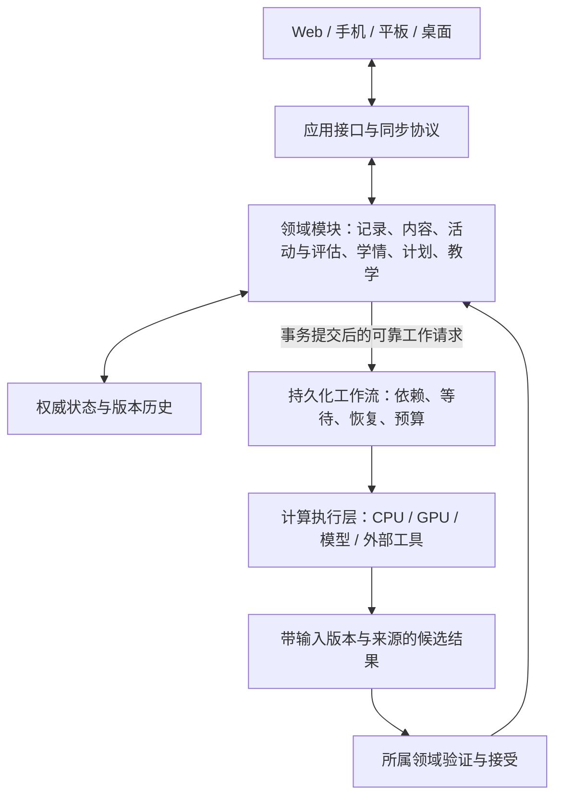

# the-learning-project 重构 PRD

**长期产品与架构需求｜2026-11-15｜提案**

本次重构的目标是构建一个能够持续理解学习者、替学习者做准备、并接受学习者纠正的学习系统。它应当容纳大量计算、复杂后台工作、多端使用和可替换的智能模块，也应当允许成本较低的开发模型在有限上下文中可靠地完成独立工作。

这份 PRD 定义目标结构、产品承诺、扩展方式与验收标准，不安排版本、时间线或功能交付批次。阅读范围限于历史记忆、产品愿景、领域术语和架构设计资料，未深入实现代码，也未验证最新部署。下述结构是本次提出的设计，不代表旧系统已经具备，也不是对当前代码根因的审计结论。

## 1. 要重建的产品

### 1.1 产品身份

一个长期陪伴学习者的私人教研系统：接住真实学习经历，形成可质疑的理解，安排值得做的活动，提前准备材料，并通过之后的表现检验帮助是否有效。

学习者可以带入卷子、教材、笔记、代码、作品和对话；可以练习、阅读、探索、论证、做项目；可以要求系统主动安排，也可以只保存材料。题库、复习、笔记、知识图谱和对话都继续有价值，它们服务于学习者的目标，不规定所有学习只能是什么形状。

历史愿景已经提出“你不在时为你工作”、泛用学习框架、可纠正的学情判断，以及学习者保留方向盘。这些是本次保留的产品意图；历史文件中的具体分期、表结构和框架选择不自动成为新架构的前提。见[私人教研团愿景](/Volumes/YukovalSBak/yukoval-projects/tlp-docs/repo-docs/docs/archive/superpowers/specs/2026-06-18-private-teaching-research-team-vision.md:12)与[七根支柱](/Volumes/YukovalSBak/yukoval-projects/tlp-status/vision-pillars.md:12)。

### 1.2 本次明确的五项野心

| 方向 | 系统应当允许的事情 | 必须付出的架构承诺 |
| --- | --- | --- |
| 远更多计算 | 全量材料重分析、知识结构搜索、并行解题与验证、大规模候选评估、个人模型校准 | 在线交互与重计算隔离；可分片、可恢复、有资源预算；结果可复用、可判定是否过时 |
| 复杂后台工作 | 长期备课、材料补全、依赖等待、条件分支、多轮研究、人工确认、周期复盘 | 持久化工作状态；明确停止、重试、取消与升级语义；能够解释卡在哪里 |
| 超出 LLM 的智能 | 统计推断、记忆模型、约束优化、符号求解、检索、仿真、本地模型与混合方法 | 算法与 LLM 具有同等接入地位；输入输出保留领域含义；不要求一切变成聊天或 prompt |
| 多端使用 | 手机采集、平板作答、电脑深度学习；换设备继续；短暂离线保留工作 | 稳定身份、可同步记录、冲突规则、可恢复提交；权威判断不依赖某一客户端 |
| AI 模块与插件 | 更换规划器、评分器、学科方法、数据源和计算后端；组合不同智能方法 | 明确扩展位置、版本、权限和质量证据；安装与激活分离；插件退出不带走用户数据 |

开发方式也是产品的生产约束：功能增长不能要求每个开发者理解整个系统，不能让节省的模型费用转变成人工集成、审查和返工成本。

### 1.3 学习者应当感受到的结果

- 我交给系统的东西和已经做过的工作不会因刷新、换设备或后台失败而丢失。
- 它能解释为什么推荐这件事、依据是什么、哪些地方还不知道；我纠正后，后续安排会真的改变。
- 它会在我不在线时完成有价值的准备；我回来能直接使用成果，无须先管理一组后台代理。
- 它能支持新的学科和学习方式，而不是把作文、项目、实验都压成选择题。
- 我能控制目标、打断安排、锁定计划、限制数据用途与计算支出；它不会用“个性化”取消这些权利。

## 2. 重构究竟要消除什么

项目此前已经尝试领域拆分、公开端口和防回退审计。历史文档也明确指出：文件变短并不证明整体解耦；静态审计不能证明职责声明正确；稳定接口与无意义转发可能被同一条语法规则混淆。见[深化复盘](/Volumes/YukovalSBak/yukoval-projects/tlp-docs/planning/2026-10-19-architecture-deepening.md:55)、[公开契约分类](/Volumes/YukovalSBak/yukoval-projects/tlp-docs/planning/2026-10-21-architecture-public-port-classification.md:17)与[机器验证边界](/Volumes/YukovalSBak/yukoval-projects/tlp-docs/planning/2026-10-20-architecture-regression-ratchets-delivery.md:244)。

据此，本次设计采用以下问题假设。它们需要后续定点核查，不能冒充已确认的现状缺陷。

| 结构性问题假设 | 重构后的要求 |
| --- | --- |
| 一个普通改动需要理解多处内部状态、调用顺序和恢复逻辑 | 一个模块对外承担完整业务操作，内部顺序与恢复由它自己负责 |
| 同一“正确”“掌握”“完成”在不同页面和后台流程各算一次 | 每类判断有唯一生效责任方，其他位置消费明确版本的结果 |
| 更换框架或移动文件没有减少协作知识 | 用真实变更的修改范围、协调次数和返工验证结构收益 |
| 成功的模型调用被当作成功的产品交付 | 分开记录执行完成、结果通过验证、结果生效、用户可用 |
| 新能力必须修改中央联合类型、全局工具表或共享大文件 | 普通扩展在自身模块登记；核心只在业务语义真正变化时调整 |
| 正确性依赖开发模型记住大量禁止事项 | 能用依赖权限、数据库约束、协议和行为检查表达的限制，由机器执行 |

**“优雅”的验收含义：少量稳定概念，清楚的职责，局部可理解的变化，以及能够删除、替换和恢复的实现。** 文件数、抽象层数和使用了多少先进框架都不是成功指标。

## 3. 推荐的总体结构

采用 **模块化的业务控制层 + 持久化工作流 + 可独立扩展的计算执行层 + 多端客户端**。

业务控制层保持同一代码库、统一发布和清晰模块边界。重计算、外部工具和不可信插件运行在受控执行环境中，能够独立增加机器或资源。只有出现明确的资源、故障或权限隔离需求，才增加部署边界；领域模块不自动变成微服务。

图中箭头表示运行时的信息流，不代表模块可以循环导入。各领域公开自身契约，组合与工作流在上层协调；领域实现不反向依赖客户端、具体模型 SDK 或执行框架。

这个结构作出三个关键选择：

1. **权威集中于职责，计算可以分散。** 任何计算节点都可以提出结果，只有对应领域模块可以把它接受为生效状态。学习判断、计划承诺与原始记录各有自己的责任方。
2. **智能实现可以多样，业务含义保持稳定。** 规划器可以从 LLM 变成约束求解器或二者组合，学习者不需要迁移自己的目标与历史。
3. **开发并行发生在稳定契约之后。** 普通实现不竞争中央状态和共享文件；真正改变领域语义的工作仍需协调，不能靠增加代理数量消除。

这里的“集中”不意味着所有命令经过一个巨型函数、全局事务或全局锁，也不意味着所有记录装入一张万能事件表。

例如，学习者在手机上带入新教材和最近的作业，希望系统为一次考试准备。记录模块先保存材料并返回可恢复回执；后台分别执行抽取、知识映射、薄弱点估计、候选材料准备与时间安排优化。其中有些步骤调用模型，有些是图算法或数学优化，互不依赖的步骤可以并行。

学习者在平板上继续当前活动，不必等整批分析结束。如果中途改了考试范围，已经完成的通用抽取结果可以复用；依赖旧范围的计划只能成为历史候选。最终成果由对应领域接受，客户端展示可使用的材料和安排。增加一个新规划算法只改变规划扩展与其验证材料，不要求重写采集、作答和同步。这是总体结构必须支持的一次完整使用情境，不是实施顺序。

## 4. 长期稳定的领域语义

### 4.1 必须分开的概念

| 概念 | 精确定义 | 不能混淆成什么 |
| --- | --- | --- |
| 学习目标 | 学习者希望达到的能力或完成的事情，含限制和验收条件 | 任务列表、系统自行决定的目标 |
| 学习材料 | 可被阅读、练习、操作或引用的有版本内容 | 学习者已经掌握的证据 |
| 学习活动 | 一次有目的的学习经历，可以是练习、阅读、项目、实验或讨论 | 必须有分数的一道题 |
| 观察记录 | 发生过什么，来源是谁，发生和接收时间是什么 | 对能力、动机或错误原因的解释 |
| 评估结果 | 按指定标准对指定提交的判断，带评分依据和生效状态 | 未经采纳的模型输出、学习者自评 |
| 学情判断 | 基于明确证据和方法，对能力、记忆、误解等提出的可修订推断 | 一项永久属性或无条件的百分数 |
| 学习安排 | 在目标、时间、资源及学习者约束下选择的活动与顺序 | 已经完成的学习事实 |
| 计算结果 | 一次算法、模型或工具执行的产物及运行凭据 | 已生效的评估、计划或用户可见成果 |

不同对象可以引用共同的来源与版本，但不能因为“都需要历史”就变成同一套可任意写入的 JSON 记录。

### 4.2 领域职责建议

下表定义责任边界，不要求每行单独部署。具体内部拆分可以调整，但写入责任和外部业务语义必须保留。

| 模块 | 独占的业务责任 | 对外承担的完整操作 | 必须隐藏的内部复杂度 |
| --- | --- | --- | --- |
| 学习记录 | 原始材料、外部经历、来源修订、用途与保留状态 | 接纳材料、追加经历、更正来源、导出或撤销使用 | 上传恢复、来源定位、版本链、派生失效通知 |
| 内容与知识 | 材料版本、知识身份与关系、学科语境、内容可用性 | 发布材料、维护结构、查询可用内容与能力 | 知识匹配、内容准入、索引、教材映射 |
| 学习活动与评估 | 活动实例、冻结题面或任务要求、作答提交、生效评估 | 开始或恢复活动、保存和提交作答、接受或更正评估 | 重复提交、评分组依赖、候选竞争、结果替代 |
| 学习者模型 | 对学习者的推断及其证据、条件、版本和不确定性 | 读取学情、接纳证据、纠正和重建推断 | 统计模型、证据去重、帮助依赖、记忆衰减与增量更新 |
| 目标与安排 | 目标、时间约束、学习者锁定项、生效计划 | 修改目标、请求规划、接受或调整安排、解释冲突 | 优化算法、候选比较、计划稳定性与过时方案拒收 |
| 教学与准备 | 帮助过程、教学策略执行、备课需求和成果关联 | 提供帮助、安排准备、继续教学、停止或撤回干预 | 多步教学、材料调度、智能模块组合与失败恢复 |

原件与解析修订（含 OCR 结果及人工纠正）归学习记录模块；正式发布的题目、教材等内容版本归内容与知识模块，引用确切的来源修订；活动冻结其使用的内容或任务要求版本，并拥有学习者提交与评估。来源更正产生新修订和影响通知，不直接改写已发布内容或历史作答。其他领域产生的观察仍归原领域，记录展示可以汇总引用，不建立第二份权威写入。

基础运行能力承担身份与授权、存储、工作流、计算执行、可观测性和同步运输，不拥有“是否掌握”“应当学什么”等教学政策。客户端负责交互和呈现，不复制权威判断算法。

每个模块可以内部使用多张表和多个算法。跨域读取走公开查询或明确的只读投影；跨域写入只能调用所有者的命令。报表可以组合多个读面，但不能借聚合查询获得跨域修改权。

## 5. 数据与一致性的产品要求

### 5.1 单一事实责任方，多个可替换读面

原始学习经历和接受后的业务变化保留可追溯历史；搜索索引、向量、摘要、学情投影和客户端缓存都标明可重建性质。禁止为一个新页面创造第二套“真实掌握度”。

本设计不要求全系统事件溯源。普通业务状态可以由关系表保存，必要历史由所属领域记录；事件主要用于表达已发生的业务变化和可靠通知。工作流日志不是业务事实库。

每个会影响判断的产物至少能追溯到：输入对象与版本、方法或算法版本、必要的模型与参数、生成时间、适用范围，以及接受它的依据。确定性计算可要求复现；随机计算和外部模型保存足够的运行凭据、输入与结果，不宣称一定逐字重现。

### 5.2 原子操作要在正确的地方完整

一个业务命令在所属模块内完成校验、状态变更、幂等回执和必要的待发送工作请求。数据库提交成功而任务丢失、任务已触发而业务回滚，均不允许作为正常结果。

跨模块后续处理允许异步，但必须公开中间状态与恢复责任。评估生效与其当前有效指针必须原子一致；学情重算和计划调整可以稍后完成。若某条不变量经常需要几个模块共同事务或共享锁，须重新审视边界，而不是不断扩大协调器。

数据库与通知的双写问题需要可靠提交机制；持久化工作流不自动替业务命令补上这层保证。可靠投递也可能重复，因此消费者仍须幂等。见 [AWS outbox 文档](https://docs.aws.amazon.com/prescriptive-guidance/latest/cloud-design-patterns/transactional-outbox.html)与 [Temporal Activity 文档](https://docs.temporal.io/activities)。

### 5.3 更正必须真正传播

例如，学习者纠正了系统读错的作答。系统必须保留原件与修订，定位受影响的评估与学情判断，使旧推断失效，再根据新证据更新相关安排。已锁定的计划不能被静默覆盖。

依赖由产生派生结果的模块记录，引用明确版本；系统能查出影响范围和修复状态。正式生效必须检查直接及传递依赖的有效性与用途授权。源事实更正或授权撤销一旦提交，就必须阻断受影响的旧依据产生新的生效结果，不能依赖失效通知已经到达下游；重算本身可以异步。校验与提交之间相关条件改变时，必须重验或拒绝。

例如作答更正后，即使学情缓存还没更新，引用该旧学情的规划也不能被当作当前方案接受。这个保证需要由跨域一致性契约落实，不能让每个插件自行递归查询、凭经验判断；具体机制须在设计中证明，不预设全局锁。版本较旧不自动等于失效，冻结题面等合法历史引用按所属领域的有效性规则处理。

异步更新期间，读面必须标出过时或重算中；会影响正式评分、计划生效或自动行动的决定不得使用失效依据。不能把墙上时钟或最大自增 ID 当成跨事务的完整处理水位。

### 5.4 数据自主与恢复

“仅保存”“仅用于这次活动”“允许长期分析”应当产生实际的数据访问和计算限制。撤销后，未执行的相关工作应停止，缓存和派生结果按所属规则失效；已无法撤回的外部处理如实报告。删除包含派生记录与同步防复活语义，保留不含被删内容的必要删除标记。

学习材料、记录、目标与关键历史可导出和恢复，不依赖某个插件继续安装。备份恢复必须恢复版本关系、用途限制和幂等身份，并核对恢复点之后已发生的删除、撤销与外部效果。这些保障不能只存在于同一份会被回退的快照中，应由可恢复的后续记录或外部核对凭据补足。

恢复上线前，旧执行实例失去提交资格。无法核对的相关数据、授权与工作保持隔离或未知，不恢复可见性、不给予执行授权、不自动重放；按事实恢复后再开放。回退数据库或代码不会撤销已经发生的外部效果。

## 6. 大量计算与复杂后台任务

### 6.1 编排、计算和接受结果分别负责

**工作流回答“接下来做什么、等什么、失败后怎样继续”；执行器回答“这一步怎样算”；领域模块回答“这个结果是否应当生效”。**

工作流需要支持长时间等待、分支、受限循环、分片并行与汇合、依赖取消、人工输入、部分成功和恢复。流程定义属于提出业务需求的模块；运行状态与执行基础设施属于平台。不能把教学政策藏进通用工作流引擎，也不能在每个功能里重写一套重试引擎。

长期运行中的工作必须绑定流程与执行代码版本。部署新版本时明确继续旧版本、迁移状态或受控终止，不能让旧记录突然按新流程解释。无限增长的流程历史需要分段续接和检查点；续接必须保留业务身份、预算和效果回执。不能让一个永久运行的工作流承担整个人的终身学习史。

### 6.2 计算执行器是一等扩展位置

下列执行器共享运行控制要求，但各自保留有类型的领域结果：

- CPU 工作：图分析、统计推断、索引重建、模拟和约束求解。
- GPU 或加速工作：本地模型推理、批量向量处理，以及有实际需要的训练或校准。
- 外部模型工作：文本、多模态、语音等提供方调用。
- 工具工作：符号计算、代码评测、资料检索、文件转换与第三方数据接入。

它们可以使用合适的语言和库。业务控制层不为接入 Python 或 Rust 算法复制一份领域状态，也不把大型数据和模型权重塞进工作流历史。大输入、检查点和输出通过受控对象引用传递。耗时短、无副作用的纯计算仍可留在所属模块内；增加独立执行边界要有资源、恢复或权限方面的理由。

执行器不持有业务数据库的通用写权限。需要业务操作时使用受限命令；普通计算返回候选结果。候选接受时校验来源、版本、适用范围、质量条件和操作权限，不能只验证 JSON 形状。

### 6.3 调度与资源隔离

系统分别管理在线交互、近期备课、批处理与探索性计算的资源份额。后台压力不得耗尽在线请求需要的进程、内存或数据库连接；优先级之外需要配额、并发上限、背压和防饥饿规则。

计算节点应按数据位置、运行环境和权限选择；远端执行只取得本次任务需要的输入，数据传输与结果保留也计入成本。高频进度与大批中间结果不能以无界写入压垮业务数据库。

预算覆盖模型费用、CPU/GPU 时长、内存、存储、网络和外部 API 限额。任务树的子任务共享上层预算，递归调用不能重新获得一份额度；并行分派前预留预算，未知费用继续占用必要额度直到核对。资源预留、实际消耗和剩余量可核对；费用或结果未知时不伪装成零。

调度器声明的资源数量只是调度条件；内存、进程和网络等硬限制由实际运行环境执行，不能把标签当隔离保证。参见 [Ray 对逻辑资源的说明](https://docs.ray.io/en/latest/ray-core/scheduling/resources.html#physical-resources-and-logical-resources)；该限制也提醒本设计应分别验证调度与实际隔离。

### 6.4 恢复与副作用

每项长任务有稳定身份、执行尝试、检查点、输入版本和明确状态。取消请求、取消确认与已经发生的不可逆效果分开；超时只说明等待结束，不证明工作没有执行。失去执行资格的旧 worker 即使继续运行，其迟到结果也不能覆盖新任务或重新生效；接受结果时同时核对业务版本与当前执行资格。

相同已确认的业务效果不得因重复投递再次生效。对于外部模型或工具已执行但回执丢失的情况，优先按供应方可用的幂等键或查询接口核对；不能确认就进入具名的未知状态，由预设预算政策或显式决定处理，不能保证不存在的“全链路 exactly once”。

有代价的结果尽量复用。复用键包含相关输入版本、算法或模型配置、用途授权和有效期；不能仅按 prompt 文本或任务名字命中缓存。重算通过依赖关系只处理受影响部分，不把每天全量运行当默认设计。

### 6.5 产出必须可用

每次准备工作区分：正在计算、计算结束、验证通过、已被领域接受、学习者可以使用。系统必须能从学习者看到的成果追到工作请求与证据，也能从失败任务定位受影响的学习活动。

允许内部运行很多算法和代理，但学习者看到的是清楚的成果、原因与可操作的失败出口。内部工单数量和代理对话量不应成为产品主界面。

## 7. 可替换的智能与插件

### 7.1 不把智能等同于供应商接口

“换一个模型”与“换一种推断方法”是两种扩展。系统至少需要以下具体扩展位置，不能全部压成 `run(prompt) -> text`：

| 扩展位置 | 输入与输出举例 | 生效责任方 |
| --- | --- | --- |
| 数据源与解析器 | 原始资料 → 带来源定位的解析修订；发布为内容是后续命令 | 学习记录接纳解析；内容与知识独立接受发布 |
| 活动类型 | 任务要求与交互 → 提交和观察记录 | 学习活动与评估 |
| 求解与评分方法 | 冻结任务、提交、评分标准 → 候选评估及依据 | 学习活动与评估 |
| 学情估计方法 | 合格证据集 → 带条件和不确定性的候选推断 | 学习者模型 |
| 规划策略 | 目标、约束、学情快照 → 候选安排与取舍 | 目标与安排 |
| 教学方法 | 活动语境与帮助需求 → 教学步骤、材料请求和观察要求 | 教学与准备 |
| 计算后端与模型适配器 | 有版本的执行请求 → 执行结果、成本和运行凭据 | 计算平台；不自行决定教学语义 |

学科内容和方法论可以是版本化数据包；具备副作用或计算行为的扩展才需要可执行插件。声明“支持作文”不能直接获得正式判分权，必须有适用范围和验证证据。

### 7.2 最小插件契约

插件声明身份与版本、宿主协议版本、扩展位置、输入输出契约、所需数据范围、允许操作、网络或工具权限、资源需求与可用平台。其权限由宿主授予，不由插件自行声明后自动获得。

契约还包括失败含义、取消和重试约定，以及对应扩展位置要求的验证样例。插件 SDK 可以提供模板和测试入口，但不得暴露宿主内部表、全局容器或任意服务定位器。

**核心可以不知道插件的名字，但必须知道插件产物的领域含义与接受规则。** 真正新增一种产品语义时允许修改核心契约，不能用无限开放的 `any` 或命名空间逃避设计。

### 7.3 两种信任边界

内置或经过同等审查的模块可以参与编译并在受信任进程运行；其包边界主要防止意外耦合。第三方或模型临时生成的可执行插件，在独立的受限执行环境运行，通过能力接口接入，不获得主进程环境变量、通用数据库账号或完整用户目录。

进程隔离本身仍不等于权限隔离，文件、网络、凭据和资源必须有实际限制。普通 JavaScript 模块以及 `node:vm` 都不能被当成运行不可信代码的安全保证。其中 `node:vm` 的限制见 [Node.js 官方文档](https://nodejs.org/api/vm.html#vm-executing-javascript)。

插件的 UI 贡献也要有边界：受信任组件可进入宿主界面；不可信脚本不能直接获得宿主页面上下文与会话凭据。数据与消息仍受相同授权约束。

### 7.4 激活、升级与退出

安装、试运行、激活和赋予写操作权限分别处理。插件可以在影子模式输出候选，和现役方法对比而不改变真实状态。质量下降、协议不兼容或权限被撤销时能停用或回到已有版本。

运行中的任务绑定明确插件版本；升级须声明兼容、保留旧执行器或如何终止旧任务。卸载后，已接受的学习事实和材料仍可读取和导出。插件私有的可重建缓存可以删除；不能让用户成果只有一个已消失插件能解释。新的内容或活动类型必须提供宿主可长期读取的基础表示、必要资源和语义说明；特殊交互可以失效，但已有学习工作不能只剩一团无法解释的插件二进制。

### 7.5 方法质量也是扩展契约

每种评分、估计或规划方法声明适用范围、已验证条件与拒绝判断条件。比较方法使用固定版本的代表性样本、真实纠错记录和适当基线，分别观察质量、延迟与资源代价；不能仅以模型互相同意作为可靠答案。用于选择或调参的样本与用于报告效果的样本要能区分，避免把见过的答案当泛化证据。

换模型、改 prompt、改参数或算法都形成可识别的新方法版本。影子结果不进入正式学习史；新方法通过对应领域验收后才可激活，低置信或超出验证范围时允许弃权。对学习效果的改进保持独立检验，不由同一方法给自己打分。

## 8. 多端是一套数据协议

客户端可以拥有适合设备的界面、输入方式和本地缓存，共享业务协议与核心数据含义。网页服务端函数不能成为手机、平板或桌面唯一可用却无法调用的隐藏业务入口。

### 8.1 明确支持的离线语义

本方案提出：材料采集、笔记与作答草稿可以本地保存；已下载活动可以继续，操作保留到重新联网。需要远端计算的评估、动态安排和准备工作标为等待同步或等待计算。它不承诺完整离线智能，也不把离线产生的客户端猜测当成正式判定。

手机离线完成活动后换电脑，未上传部分必须明确显示尚未同步；客户端不能宣称其他设备已经收到自己只存于本地的数据。

### 8.2 按对象定义冲突规则

| 对象 | 同步规则 |
| --- | --- |
| 发生过的学习动作 | 按稳定操作身份追加、去重；保留设备来源与发生时间，服务端记录接收顺序 |
| 草稿与笔记 | 允许局部自动合并；无法合理合并时保留双方，呈现冲突。CRDT 仅在需要共同编辑的对象上评估 |
| 正式作答提交 | 按活动或发放身份、提交身份和基础版本接纳；同一提交重试返回原回执，不按答案文本误删重复练习 |
| 生效评估与计划 | 由所属领域校验版本和约束后变更；客户端不能通过“最后写入赢”覆盖新判定或学习者锁定项 |
| 删除与撤销用途 | 保留必要标记和版本；旧设备重新上线不能复活已删除数据或重新提交已撤销的工作 |

本地优先研究说明了离线、多设备与数据控制的价值；这里采用的是按对象选择一致性语义的设计，不是把所有业务状态都做成任意端可合并的文档。参见 [Ink & Switch 原始研究](https://www.inkandswitch.com/essay/local-first/)。

同步协议需要增量游标、缺口检测与全量恢复，断线推送只负责提醒更新，最终状态可以主动拉取恢复。移动端长期停留旧版本时，要给出兼容范围和可恢复升级路径，不能悄悄丢弃不认识的数据。

多端支持不自动扩张为多人 SaaS。当前仍以同一学习者跨设备为中心，区分学习者、操作者与设备身份；共享与多人授权是独立产品决定。

## 9. 让低成本模型成为可靠的并行开发者

### 9.1 可并行开发的工作单元

一个普通任务应当只需要：所属模块的业务语义、公开契约、几个真实使用样例、局部运行方式，以及本次验收要求。模型不必读全仓，也不必知道别的模块怎样加锁、怎样存表、怎样重试。

模块应同时拥有完成职责所需的实现、存储适配、迁移、后台流程和对外行为检查。不要按 controller/service/repository 分给三个代理，让每项功能都变成跨团队协调。

只有共享语义变化、权限边界、数据迁移与关键一致性变化需要集中设计和高质量审查。简单实现不必升级成一次架构会议；低价模型也不能自行重定义“正确”“掌握”或“可以发布”。

### 9.2 开发环境必须实际提供的能力

- 生成任务所需的局部上下文：模块说明、契约、依赖版本和相关失败样例；生成内容可从源码与契约核对，不靠持续维护平行手册。
- 一个入口启动指定模块的验证环境，提供确定性外部替身与有需要的真实数据库；无需全系统或付费模型全部在线。
- 任务隔离工作树、数据库或 schema、端口和临时资源。不同写者不共享工作目录或可变数据库状态。
- 模块各自维护增量迁移文件，整合时检查依赖和冲突；禁止大家同时重写一份全局 schema 快照或手工争用顺序编号。
- 按受影响的依赖图运行验证；共享契约改变时自动覆盖真实消费者。整合分支上的检查对合并结果执行，不能只接受各分支单独通过。

### 9.3 由机器守住哪些边界

| 边界 | 必须有的执行机制 | 它不能证明什么 |
| --- | --- | --- |
| 模块依赖 | 显式包出口、禁止内部路径绕入、依赖图及环检查 | 职责划分本身合理 |
| 状态所有权 | 模块专属存储接口；运行账号按需要限制；执行插件无通用写权限 | 所有同进程代码已形成敌对安全隔离 |
| 契约一致 | 运行时输入验证、消费者兼容检查、来自契约的客户端生成 | 字段含义没有被偷偷改变 |
| 并发与重复操作 | 数据库约束、幂等身份、预期版本和真实边界验证 | 外部供应方从未重复执行 |
| 输出生效 | 领域接受规则、输入版本检查、权限与质量条件 | 教育判断一定正确 |
| 任务集成 | 改动范围检查、受保护的核心契约、合并结果验证 | 任意数量的需求都能够同时开发 |

模块依赖工具能检查导入和项目依赖，但不能替代语义验收；选用现成工具完成机械检查，不继续制造一套需要大量豁免文案的架构评分系统。例如 [Nx 的模块边界检查](https://nx.dev/docs/features/enforce-module-boundaries)；工具的具体采用仍需结合项目验证。

### 9.4 防止新一轮 slop

常见扩展应有一条简明的默认路径。两种真实变化需要不同时才增加抽象；为多个学科添加不同内容不应复制整套业务流程，为两种真正不同的活动也不应堆满条件开关。

不以行数、包装层或代理数量作为产能。检查接口时要回答：调用者还需要知道哪些隐藏顺序？模块删掉后，哪些复杂度会回到调用方？新增一种算法是否逼迫无关模块理解它？

包可以有很薄的公开出口，只要背后承担完整责任；不要求为了证明“深度”往出口塞逻辑。重复业务政策、任意跨域 SQL、服务定位器、万能上下文对象和通用插件基类，都不能成为绕开边界的捷径。

**开发模型负责写实现，运行时智能负责产出教学候选；两者都不能凭自己的解释获得新的权威。** 开发质量通过可执行边界和集成验收约束，教学质量通过领域验证和真实效果证据约束。

## 10. 技术取向与选择边界

| 议题 | 推荐取向 | 选择理由与约束 |
| --- | --- | --- |
| 代码组织 | 同仓库、显式领域包、单一应用组合根 | 降低契约演进和原子修改成本；普通扩展不竞争手写中央清单 |
| 业务控制层 | 按业务、计算与 agent 的契约协作成本选择语言；框架留在入口与适配层 | 旧项目语言不构成沿用理由；类型检查、运行校验与模块权限必须可执行 |
| 权威存储 | 关系数据库保存业务状态和必要历史；PostgreSQL 为默认候选 | 支持事务与约束；按模块所有权组织，避免每个域自建存储服务 |
| 大数据与材料 | 对象存储保存原件、批量结果与检查点；索引可重建 | 大型计算产物不挤占业务行和工作流日志 |
| 后台运行 | 一个持久化编排责任方，接多种受控执行器 | 工作流引擎与算力调度分工；不维持两套互相不知情的重试和状态解释 |
| 计算语言 | 按真实计算需要使用 Python、Rust 等隔离执行器 | 不强迫算法迁就应用语言；禁止复制核心业务权威 |
| 多端 | 稳定应用协议、设备侧缓存与同步、设备适配 UI | 保留原生端可能；不要求所有端共用一套界面组件 |
| 插件 | 具体扩展位置、版本化协议、分级权限与实际隔离 | 允许灵活组合，限制扩展对系统状态和资源的破坏范围 |

全部技术按长期维护、扩展能力和低成本模型并行开发重新比较；旧项目的使用情况不计入选型依据。具体结论见[架构设计](architecture.md)与[技术选型裁决](technology-decisions.md)：选择 Python/FastAPI/Pydantic 后端与 Pydantic AI/Temporal agent 运行体系。产品模块边界不依赖这几个框架的私有对象。

Agent 必须保留多轮工具使用、持续会话、受限委派、上下文与记忆、主动后台工作的能力。会话事实、执行恢复、工具授权与学习状态分别有清晰所有者；不能为简化技术栈把 agent 降为一次性文本生成，也不能让其绕过领域接纳。

执行框架的选择必须用本 PRD 的长任务恢复、版本升级、资源隔离、未知副作用、部署维护和多语言执行要求进行验证。若一个成熟工具能满足，不重写通用引擎；若现有工具无法满足，也不因已投入成本继续把缺口藏进业务模块。

不预设全量微服务、全量事件溯源、全量 CRDT、通用低代码工作流编辑器或插件市场。它们只有在解决明确需求且复杂度可承担时才成立。扩展协议必须足以支撑野心，扩展的基础设施按实际执行需要部署。

## 11. 架构必须通过的真实验收

以下是最终结构的验证场景，不是开发顺序。可以用有限代表性数据与计算验证语义，再以注明规模和硬件的实验验证容量。静态设计通过不等于这些场景已经通过。

| 场景 | 必须观察到的结果 |
| --- | --- |
| 低价模型分别增加数据源、规划策略和设备界面 | 各自依靠局部契约完成；不需要阅读彼此实现；无共享核心修改时可以独立整合；记录实际协调和返工 |
| 新增符号求解器或统计学情模型 | 通过对应扩展位置接入，能输出和验证领域结果；没有把算法伪装成聊天，也没有复制一套业务数据库 |
| 大批后台计算与在线学习同时发生 | 后台被配额和背压控制；在线请求满足预定服务目标；任务堆积可见且可恢复 |
| 多分支任务中一部分 worker 被中断 | 已确认步骤不重复产生业务效果；未完成步骤可恢复；部分失败及其影响可定位 |
| 流程、插件升级时还有旧任务 | 旧任务继续使用可用的版本或受控迁移；不会读取新代码后静默误解释历史 |
| 计算期间输入被纠正或用途被撤销 | 人为延迟失效通知，并在校验与提交之间更正来源；直接或间接依赖失效依据的结果仍不能生效，受影响派生项可追踪重算或停止 |
| 手机离线作答，电脑已有更新，再恢复联网 | 记录不丢；同一操作不重复计；独立练习不被误去重；冲突明确；旧设备不覆盖新判定 |
| 重复提交、候选同时完成、回执丢失 | 生效结果与回执保持一致；重复请求可恢复；外部结果未知时如实进入恢复流程 |
| 插件申请越权、耗尽资源或运行失败 | 权限或运行环境实际阻断；在线学习与其他插件继续可用；无宿主凭据泄漏 |
| 停用某个模型、插件或计算服务 | 已接受记录仍可读取导出；未支持能力被明确标识；允许换用兼容实现 |
| 新增非刷题活动，例如代码项目或实验 | 保留活动自身提交与证据语义；不能自动判的环节如实表达；不伪造分数或掌握度 |
| 从早于删除、撤销和外部效果完成的备份恢复 | 补回或核对后续事实；无法确认的范围隔离并停止自动重放；旧执行实例无法提交，已删除数据不复活、已完成效果不重复 |

验收证据分四层：结构与契约、确定性行为、真实运行、学习效果。每层单独报告。模型调用成功不能证明判断准确，任务完成不能证明用户拿到成果，学习者打开更多次也不能单独证明学得更好。

## 12. 成功如何衡量

### 12.1 开发成本与变化局部性

在难度相近的真实任务上，记录需要理解和修改的模块数、契约协调次数、集成等待、人工审查时间、返工量，以及最终接受的变更数。总开发成本包含模型费用、计算费用、人工判断和返工，不能只按生成 token 单价评估。

并行实验保持任务组合、质量要求和资源条件可比，逐渐增加同时进行的独立工作，观察吞吐量与返工。架构应提高可靠完成的产量，而不是让更多代理同时忙碌。共享不变量与计算资源造成的串行部分必须报告。

### 12.2 运行质量

分别测量在线交互延迟、后台排队与完成时间、重复业务效果、丢失任务、过时结果误接受、恢复时间、预算超支和计算结果复用。性能报告必须注明数据规模、任务形状、硬件与故障条件。

任务接受与状态查询不得等待重计算结束；耗时工作通过持久化身份继续。具体时延和容量数值需由代表性负载确定，不在没有测量时编造吞吐承诺。零丢失已确认作答、零越权写入和零重复生效属于正确性要求，不用平均指标稀释。

### 12.3 产品质量

观察学习者是否能顺畅接续、是否减少整理和决策负担、准备好的材料是否被使用、系统纠正是否真正生效，以及独立完成、保持和迁移表现。计算增加必须换来这些结果之一；无法证明价值的计算可停用，不让后台规模本身成为目标。

## 13. 与旧系统的关系

本 PRD 保留产品意图、用户数据和已经证明有价值的能力，不默认保留每个旧抽象。算法、内容和行为资产能否复用，应按语义正确、契约清楚、依赖可控与验证充分判断，不能因文件现在存在就把它升级成新架构中心。

替换边界需要可核对的输入输出、数据映射、权威切换和恢复条件。相同业务操作只能有一个生效写入责任方；影子计算可以并行，不能双写两个互不一致的真相。旧记录缺少来源或版本时标为未知，不补造历史。

旧适配层只承担兼容和转换，不继续生长产品政策。只有实际消费者和存量任务退出后才能删除。本次只产出设计文档，现有代码、数据与部署均未修改。

## 14. 尚需定案的设计变量

以下问题影响具体技术取舍，但不影响本 PRD 的主体边界：

- 计算规模的代表样本：数据体量、任务持续时间、并行宽度、本地与远端算力、CPU/GPU 比例与可接受月支出。
- 多端的具体覆盖：浏览器之外需要哪些原生设备能力，以及离线需要持续多久。当前方案要求离线保留工作与恢复，不假设全端完整离线推理。
- 插件信任范围：自写扩展、审查后的共享包、第三方包、模型临时生成代码分别允许什么。当前方案保留可信模块与隔离执行两条路径，不预设公开市场。
- 算法效果的评估材料：哪些领域有可靠答案或教师评分，哪些只能保留不确定性和人工纠正。

这些是具体设计输入，不应再用“先做一个小版本”替代。结构是否合格，按前述产品承诺与验收场景判断。

## 资料与依据

### 项目来源

A. [私人教研团产品愿景，2026-06-18](/Volumes/YukovalSBak/yukoval-projects/tlp-docs/repo-docs/docs/archive/superpowers/specs/2026-06-18-private-teaching-research-team-vision.md)：长期意图、泛用学习、教研职能、学习者控制与历史设计修正。取产品意图，不沿用分期。

B. [愿景七根支柱，2026-10-10](/Volumes/YukovalSBak/yukoval-projects/tlp-status/vision-pillars.md)：记录、画像、主动准备、学科语境、内容供给、帮助分寸和可检验性。为历史评审稿，不能作为当前实现证明。

C. [架构深化：目标、职责与交付证据](/Volumes/YukovalSBak/yukoval-projects/tlp-docs/planning/2026-10-19-architecture-deepening.md:15)：并行、调用者负担和真实变更局部性；第 55 行明确局部整理不等于整体解耦。

D. [稳定公开契约与兼容转发分类](/Volumes/YukovalSBak/yukoval-projects/tlp-docs/planning/2026-10-21-architecture-public-port-classification.md:17)及[机器验证边界](/Volumes/YukovalSBak/yukoval-projects/tlp-docs/planning/2026-10-20-architecture-regression-ratchets-delivery.md:244)：静态形状与语义职责的区别。

E. [Hono 留还是退，2026-11-08](/Volumes/YukovalSBak/yukoval-projects/tlp-docs/design/2026-11-08-hono-keep-or-retire.md)：历史的运输层取舍分析，本次未复核其中源码计数与运行状态。

F. [领域术语表](/Volumes/YukovalSBak/yukoval-projects/the-learning-project/CONTEXT.md:16)及[知识点学情档案交付契约，2026-11-14](/Volumes/YukovalSBak/yukoval-projects/tlp-docs/design/2026-11-14-learner-profile-contract.md:5)：事实与推断、独立作答、派生档案、新鲜度和原子刷新意图。后者明确是设计，不能当作已上线能力。

### 技术依据

T1. [Nx：Enforce Module Boundaries](https://nx.dev/docs/features/enforce-module-boundaries)。支持对导入和项目依赖施加约束；此引用不意味着必须选 Nx，也不证明模块语义正确。

T2. [AWS：Transactional outbox pattern](https://docs.aws.amazon.com/prescriptive-guidance/latest/cloud-design-patterns/transactional-outbox.html)。说明数据库与通知双写的不一致风险，以及重复消息仍需要幂等处理。

T3. [Temporal：Activities](https://docs.temporal.io/activities)。区分持久化执行与实际执行代码；官方仍要求考虑幂等副作用。引用用于语义依据，不锁定产品供应商。

T4. [Ray：Resources](https://docs.ray.io/en/latest/ray-core/scheduling/resources.html)。调度资源为逻辑资源，不能当成物理资源隔离；引用不代表必须引入 Ray 集群。

T5. [Node.js：VM](https://nodejs.org/api/vm.html)。官方明确 VM 模块不能作为安全机制运行不可信代码。

T6. [Ink & Switch：Local-first software](https://www.inkandswitch.com/essay/local-first/)。关于离线、多设备、用户数据控制与 CRDT 的原始研究；本文的对象分类同步规则是设计选择，不是该论文的现成结论。

技术资料查阅于 2026-11-15。资料支持具体机制与限制，不能证明本方案已经达到吞吐、成本、开发效率或学习效果目标。
